

# Omni360

### Get games onto your modded Xbox 360, from the Xbox 360

Browse thousands of games, DLC and title updates, install them in the background, and play them right from Omni360 - or from the dashboard or Aurora. No PC needed once it's set up.

 

**[Quick start](#quick-start)** &nbsp;·&nbsp; **[What it does](#what-it-does)** &nbsp;·&nbsp; **[Screenshots](#screenshots)** &nbsp;·&nbsp; **[Docs](docs/docs.md)**

 

## Quick start

**You need:**

- A soft-modded (BadUpdate, ABadAvatar, PeerPressure) or hard-modded (RGH, JTAG) Xbox 360, connected to the internet. Ethernet is recommended.
- A free Internet Archive account. Every collection Omni360 downloads from is marked private, so Internet Archive refuses downloads without signing in. Browsing works without one.
- Free space for installing games: the download and the installed game both, while it installs — around 7GB plus 3-8GB for a typical game. The download is removed once it's installed.

**Then:**

1. Download `Omni360.xex` from the [latest release](https://github.com/JustGillin/omni360/releases).
2. Copy `Omni360.xex` into a folder of its own on the console, and launch it.
3. Sign in to Internet Archive when it asks: scan the QR code with your phone and sign in there, or type your email and password with the controller. You can also skip it and sign in later, from the Store or Settings.

   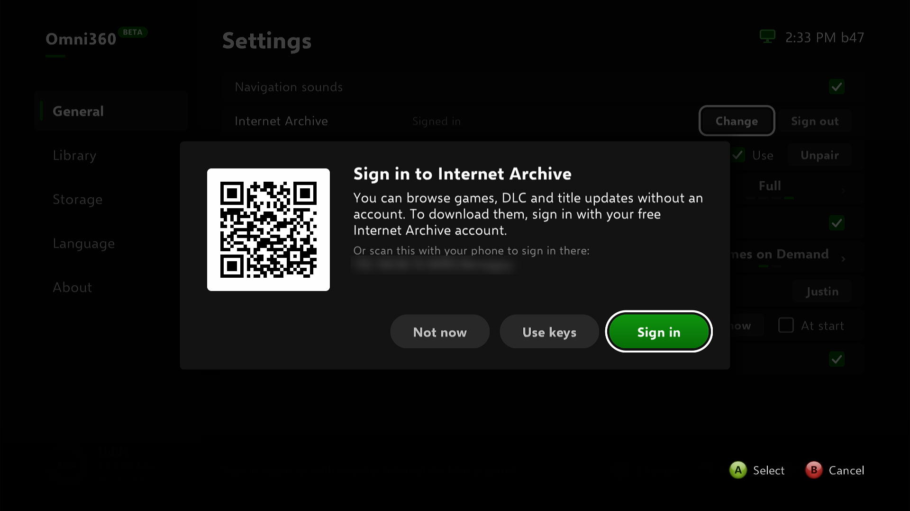

If you'd rather use keys, get them at [archive.org/account/s3.php](https://archive.org/account/s3.php) and put them in a plain text file, `ArchiveOrgKeys.txt`, beside `Omni360.xex`: access key on line 1, secret key on line 2.

The [Setup Guide](docs/Setup%20Guide.md) covers the whole thing step by step, including where games and downloads go.

 

## What it does

Omni360 is a store and a library in one app on the console.

### General

- **A home screen of its own.** It opens on the games you played last, each under its own wallpaper, with covers and artwork found for you.
- **Your whole library in one place**, read straight off the hard drive and sorted into Games, Apps, Homebrew and Emulators - point it at as many folders as you like.
- **A full store** with featured games, collections, genres, series and search, filtered by region, language or rating. Every game gets a proper page with its description, ratings, screenshots and artwork.
- **Background downloads.** Everything downloads and installs while you keep browsing, with a popup when each job finishes or fails. Nothing downloads without you choosing it.
- **Seven languages.**
- **Updates itself** from inside the app, installing only releases signed with the project's key.
- **Faster downloads with the optional [PC/Mac helper](#faster-downloads-with-the-pc-helper-optional).**

### Xbox 360

- **About 1,500 disc games** from Internet Archive, installed as Games on Demand.
- **DLC and title updates** for any of them.
- **About 700 Xbox Live Arcade and 3,400 indie games**, compilations included.
- **Play games right from the disc**, or copy one to the hard drive - the tray ejects when it's done.
- **Reads and launches** Games on Demand installs and plain `default.xex` folders alike.

### Original Xbox

- **About 1,100 games** from Internet Archive - every one Microsoft made run on the 360, and hundreds more it didn't.
- **Play games right from the disc**, or copy one to the hard drive - the tray ejects when it's done.
- **Sets up the emulator for you.** If the console is missing the partition or the files Original Xbox games run on, Omni360 offers to fix it - formatting the partition and installing ConsoleMods' unlocked emulator, which runs games beyond Microsoft's list.
- **Gets unsupported games running.** Games Microsoft never made work on the 360 are marked as such. Before one starts, Omni360 offers the emulator version players found runs it best - or lets you pick - and puts the usual one back next time it starts.
- **Known issues up front.** Before an unsupported game starts, Omni360 shows what players have reported going wrong with it.

 

## Screenshots

<table>
  <tr>
    <td width="50%">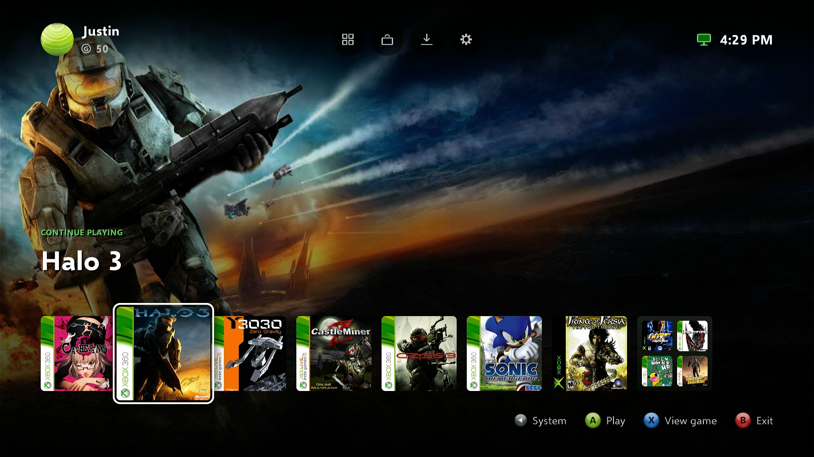 <b>Home</b>: what you played last, the disc in the drive first, under its own wallpaper.</td>
    <td width="50%">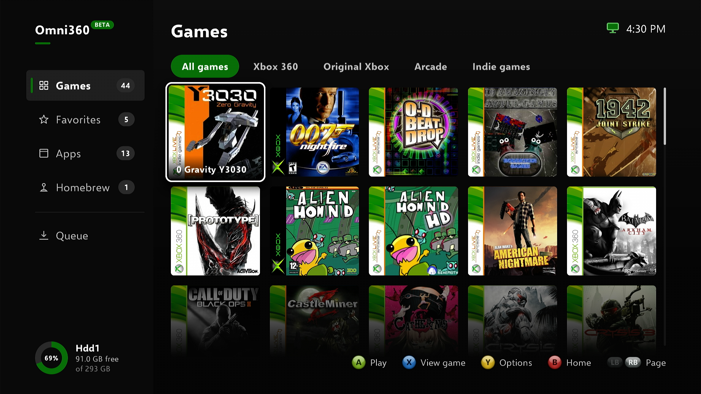 <b>Games</b>: every installed game, Xbox 360 and Original Xbox, with the disc in the drive marked.</td>
  </tr>
  <tr>
    <td width="50%">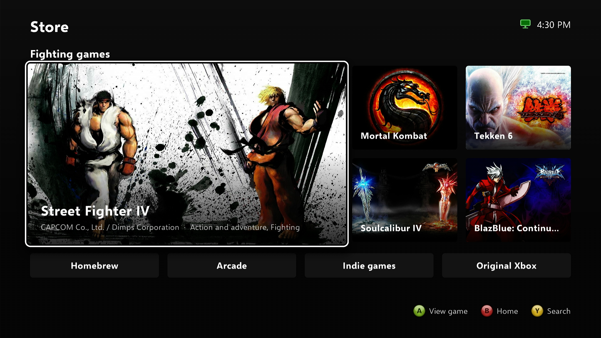 <b>Store</b>: this week's featured games, then Homebrew, XBLA, XBLIG and Original Xbox.</td>
    <td width="50%">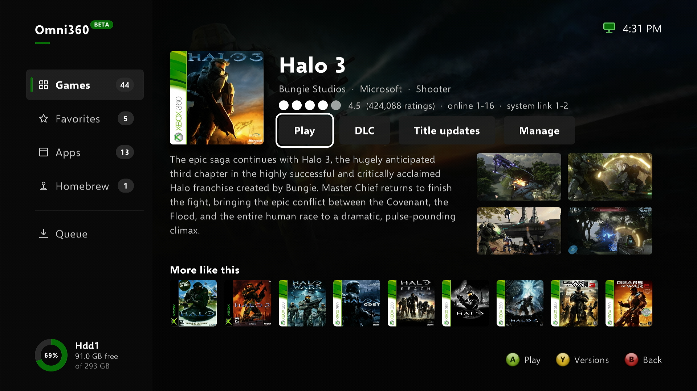 <b>A game's page</b>: description, ratings, screenshots, its DLC and its title updates.</td>
  </tr>
  <tr>
    <td width="50%">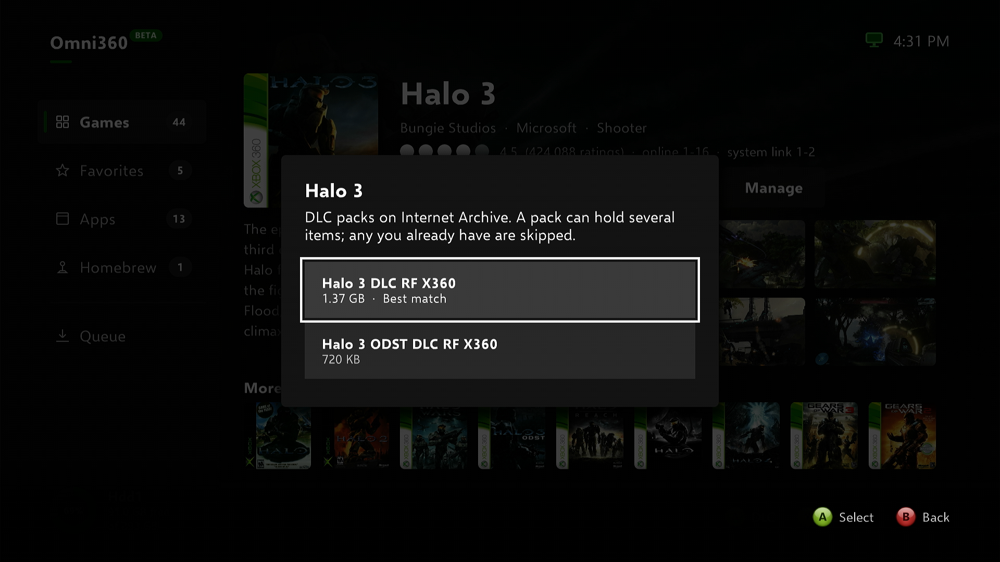 <b>DLC</b>: find the packs for any game and pick the ones you want.</td>
    <td width="50%">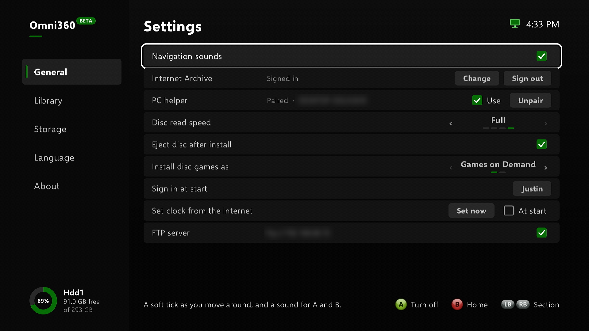 <b>Settings</b>: the folders your games, apps, homebrew and emulators live in, your Internet Archive sign-in and updates.</td>
  </tr>
  <tr>
    <td width="50%">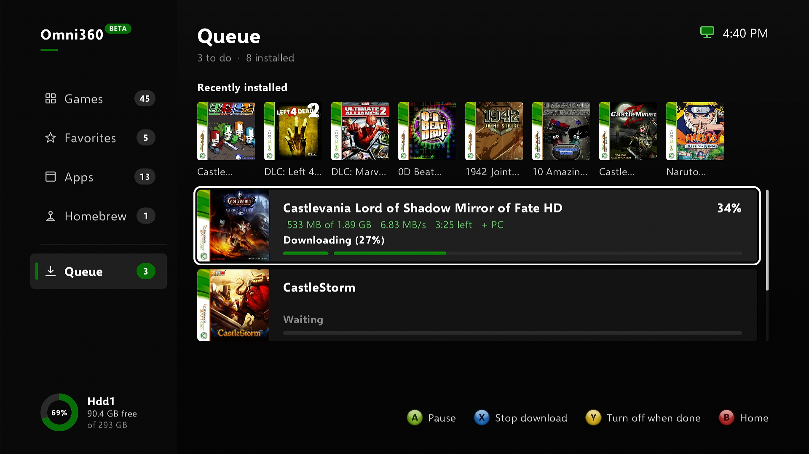 <b>Queue</b>: everything downloads and installs in the background.</td>
    <td width="50%">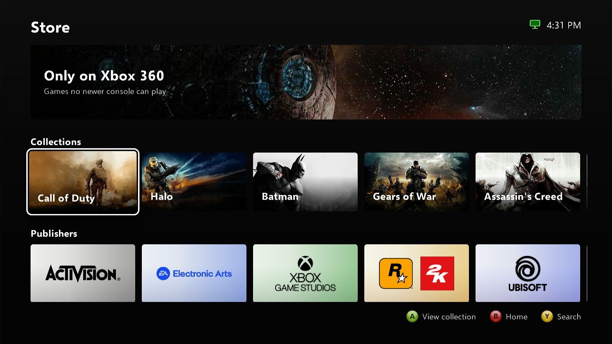 <b>Browse</b>: A to Z, or rows of Popular, Top rated and every genre.</td>
  </tr>
  <tr>
    <td width="50%">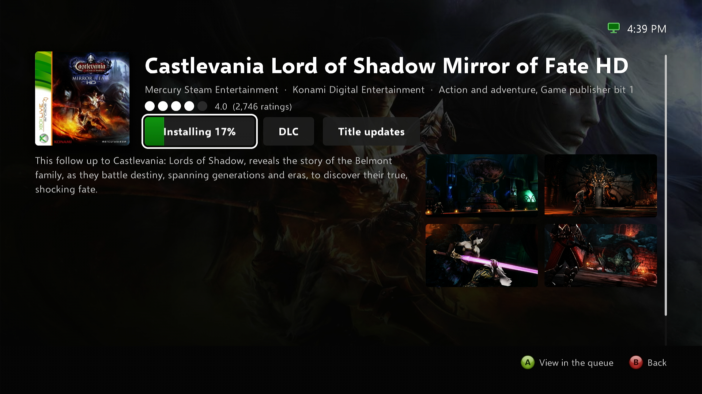 <b>Xbox Live Arcade</b>: arcade games get the same pages, and show their progress as they install.</td>
    <td width="50%"></td>
  </tr>
  <tr>
    <td colspan="2">The last three shots are older than this release.</td>
  </tr>
</table>

 

## Faster downloads with the PC helper (optional)

Omni360 works on its own, but if you have a computer on the same network, **Omni360 Helper** can often make Store downloads faster. The computer downloads from Internet Archive and hands the game straight to the console over your network, while the console still checks, installs and manages everything. It works for disc games, Arcade games, DLC and title updates.

How much faster depends on your internet and on Internet Archive that day. The console tops out around 10 MB/s through the helper, against usually 2-7 MB/s on its own. Some days it's a big jump, some days barely any - see *Why isn't it faster?* below.

1. Download the helper for your computer from the [latest release](https://github.com/JustGillin/omni360/releases) and run it:
   - **Windows:** `Omni360Helper.exe`. Allow it through Windows Firewall when asked (private networks are enough). It sits in the system tray.
   - **Mac:** `Omni360Helper-macos.zip`, which unzips to *Omni360 Helper*. The first time, right-click it and choose **Open**, since it isn't from the App Store. Allow incoming network connections when macOS asks. It sits in the menu bar.
   - **Linux:** `Omni360Helper-linux`, untested so far. Its icon needs a desktop that shows tray icons.
2. On the console: **Settings → General → PC helper → Pair**.
3. Your computer asks whether to allow the Xbox. Check it shows the same code as your TV, and allow it.

<table>
  <tr>
    <td width="55%">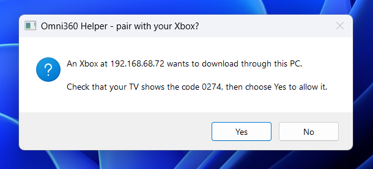 <b>Pairing</b>: allow the Xbox once, after checking the code matches your TV.</td>
    <td width="45%">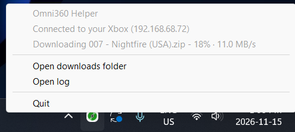 <b>The tray menu</b>: whether your Xbox is connected, and what's downloading.</td>
  </tr>
  <tr>
    <td colspan="2">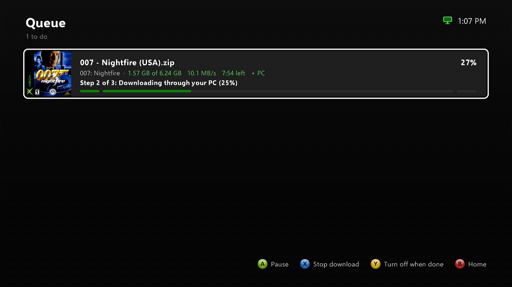 <b>On the console</b>: a download coming through your PC shows its speed in green with <b>+ PC</b>, and the monitor beside the clock says the helper is connected.</td>
  </tr>
</table>

<b>On a Mac</b>

<table>
  <tr>
    <td width="60%">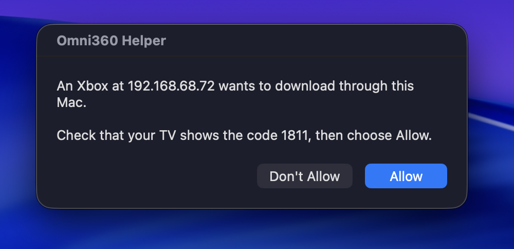 <b>Pairing</b>: the same check, as a Mac dialog.</td>
    <td width="40%">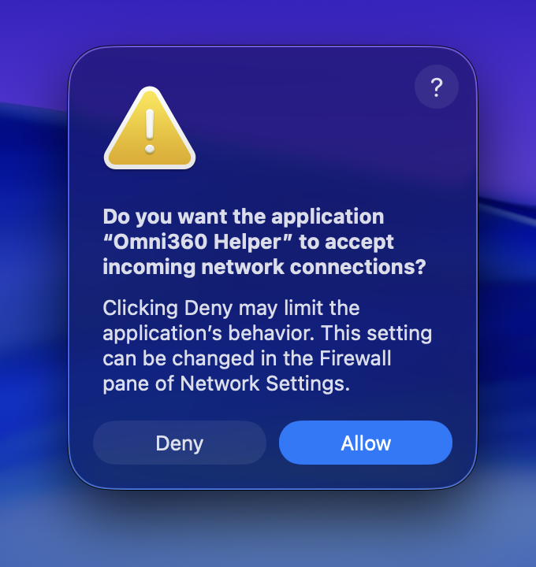 <b>The firewall</b>: choose Allow, or the Xbox can't reach it.</td>
  </tr>
  <tr>
    <td colspan="2">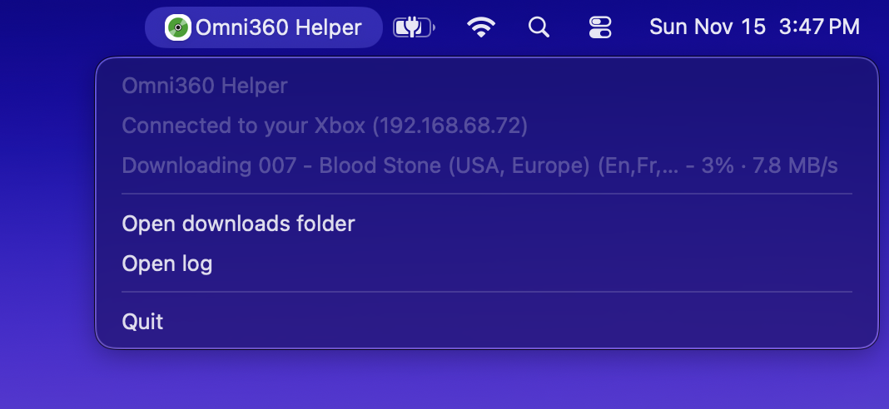 <b>The menu bar</b>: whether your Xbox is connected, and what's downloading.</td>
  </tr>
</table>

That's it. While the helper is running:

- A small green monitor sits beside the clock on the console.
- On the Queue, a download coming through your computer shows its speed in green with **+ PC**.
- The helper's icon is a green disc that spins while it downloads, and its menu shows the game and the speed. It turns grey when no Xbox is connected, such as when Omni360 is closed.

If you switch the computer off or close the helper partway through, the download carries on from Internet Archive by itself, and moves back to the computer when the helper returns. Pairing keeps other devices on your network out, since the console passes your Internet Archive keys along with each download.

- **Where downloads go:** **Change downloads folder…** in the helper's menu picks another drive or folder. The helper makes an `Omni360Helper` folder inside the one you pick and clears out the old one.
- **Updates:** from version 1.1.0 the helper updates itself. When a new release is out, its menu offers **Update to …**, and it installs the update by itself once nothing has downloaded for a while (untick **Install updates automatically** to stop that). It only installs an update signed with the project's key. If you have an older helper, download the new one from the release page once.
- If the console and the helper are too far apart in version to work together, **Settings → PC helper** says which one needs updating, and so does the helper's menu.

<b>Why it can be faster</b>

 

The 360 gives each connection a fixed 255 KB receive buffer (see *Known limitations*), so from Internet Archive's servers, tens of milliseconds away, each connection tops out around 3.5 MB/s. On your home network the round trip is about a millisecond, so the console can take data almost as fast as its 100 Mbit network port allows, around 10 MB/s.

Your computer has no such limit: it downloads with several connections at once. On a good day that's measured at 9 MB/s with four connections and 12 MB/s with eight, which keeps it ahead of the console, so the console's network port becomes the limit instead.

The helper also keeps recent downloads (50 GB by default, oldest removed first), so installing the same game on a second console is just the copy over your network.

<b>Why isn't it faster?</b>

 

The helper can only pass the game on as fast as your computer gets it from Internet Archive. A few things can make that no faster than the console on its own:

- **Internet Archive has slowed your connection down.** After a lot of downloading in one day, Internet Archive limits a household's speed, and that limit covers your computer and your console alike. Downloads often start fast and then drop off. It usually lifts by the next day.
- **That game's server is slow.** Each game lives on one of Internet Archive's servers, and some are much slower than others on a given day. Neither your computer nor your console can do anything about it.
- **Your console was already doing well.** The console tops out around 10 MB/s through the helper. If it was already getting 6-7 MB/s on its own, there's less room to gain.
- **Your computer's connection.** A computer on weak Wi-Fi may not get much more than the console does on its cable.

A good check: download the same game in your computer's web browser. If that's slow too, it's Internet Archive or your internet, not the helper. The helper's menu shows the speed it's getting, and the Queue shows the console's, so you can see which side is slower.

 

## Known limitations

- **Downloads are slower than on a PC** — usually 2-4 MB/s from Internet Archive, so a game takes half an hour or more, where a PC on the same internet gets 5-8 MB/s. It's the 360's own networking, not your internet or Omni360. **Settings → Download speed** checks your console in about a minute, and the optional [PC helper](#faster-downloads-with-the-pc-helper-optional) can get around it, up to about 10 MB/s.

  

  
<b>Why the 360 is slower over distance</b>

   

  A download connection can only have so much data on its way at once — its *receive buffer* — before it has to wait for the next round trip to the server. So one connection's top speed is that buffer divided by the round trip.

  The 360's networking won't give a connection more than **255 KB** of receive buffer, however much an app asks for: the setting is a single byte, counted in KB (`cfgSockDefaultRecvBufsizeInK` in the XDK's `winsockx.h`). Windows grows its buffer to several MB on a long connection, so a PC isn't held back the same way.

  Measured on a console with Settings' speed test (October 2026):

  | Server | Round trip | 255 KB ÷ round trip | Measured |
  |---|---|---|---|
  | CacheFly, a nearby CDN, plain HTTP | 4 ms | ~60 MB/s — the 100 Mbit port is the limit instead | 11.1 MB/s |
  | thinkbroadband, UK, plain HTTP | 100 ms | ~2.5 MB/s | 2.3 MB/s |
  | Internet Archive's storage server | 52 ms | ~4.8 MB/s | 2.2-3.4 MB/s |

  What it isn't:

  - **Your internet or the console's network port** — the nearby server reaches the 100 Mbit port's full 11 MB/s.
  - **The console's processor** — it decrypts HTTPS at about 25 MB/s per core with ChaCha20-Poly1305, which Omni360 asks Internet Archive for. (Internet Archive's servers would otherwise pick AES-GCM, which the console only manages at about 5 MB/s.)
  - **Something more connections would fix** — each connection gets its own buffer, but Internet Archive drops or stalls extra parallel requests from one console, so game installs use two.

  

- **About 20 games install slowly.** Internet Archive only has them as compressed archives (the DiRT series and Deadpool among them), which have to be unpacked on the console as they download. Deadpool took over an hour. The Store marks them and asks before starting one, and if one is stopped it starts over from the beginning. A few dozen games aren't on Internet Archive at all.
- **A multi-disc game installed some other way** — from real discs, or another tool — can't be uninstalled by version from its Store page, since Omni360 can't tell which disc is which. Its own library entry still can be, if the Store hasn't got it.
- **A scratched disc can fail partway through a disc install.** Lower the disc read speed in Settings and try again.
- **Key entry** on the on-screen keyboard isn't masked.
- **DLC matching is deliberately loose** — it has to cope with release-group names like `Halo.1.Combat.Evolved.Anniversary...` and abbreviated display names like `CoD: World at War`. It scores candidates 0-100 on how much of the game's name appears in the filename, and penalises a missing number heavily so "Halo 3" doesn't offer "Halo 4". You always confirm the pack yourself.
- **Some features won't work if Xbox Live is blocked.** Omni360 fetches game descriptions, Store artwork, wallpapers, and Xbox 360 game icons from Xbox Live. If your console uses Liveblock, Livestrong, or any other DNS-level Xbox Live block, those won't load. Original Xbox game icons come from MobCat's game list instead and aren't affected.

 

## Check out X-Store too

Omni360 started from [X-Store](https://github.com/951261/X-Store) by 951261, which at the time was a Vimm's Lair downloader. Its networking code gave Omni360 a head start, and that part is still in here (see [Credits](#credits)). The rest went a different way: the Internet Archive library, installer, DLC and title updates, and the whole interface were written for Omni360. X-Store later added Internet Archive support of its own, written separately.

The two are separate apps now, and X-Store is a great one. It's well worth trying alongside Omni360.

For how Omni360 compares with X-Store, GodStix, ConsoleCrate and ReLive — where each gets its games, what it covers, how fast it downloads, and whether it's open source — see [How Omni360 compares](docs/comparison.md).

 

## Building it yourself

You need the official Microsoft Xbox 360 XDK and Visual Studio 2010 (`XboxTLS2.vcxproj` targets `Platform=Xbox 360` directly — this is **not** buildable with the open free60/libxenon toolchain). Sourcing the XDK is on you. See [`COMPILING.md`](COMPILING.md), and [`RELEASING.md`](RELEASING.md) for publishing a version people can update to.

 

## Supporting Omni360

Omni360 is free, and always will be: no ads, no tracking, nothing locked away. The best ways to help are free too:

- **Star the repo** so more people find it.
- **[Report a bug](https://github.com/JustGillin/omni360/issues)** or a game that won't install. It's how things get fixed.
- **Tell someone** with a modded 360 who'd use it.

If you'd like to chip in anyway, you can sponsor it on GitHub. It's entirely optional, and every feature stays free either way.

 

## License

AGPL-3.0, inherited from the original X-Store project (see `LICENSE`). Vendored components keep their own licenses: BearSSL (`SSL/`, MIT), zlib (`zlib/`, zlib license), cJSON (`cJSON.c/.h`, MIT), dmc_unrar (`dmc_unrar/`, GPL-2.0-or-later), the Selawik font (OFL). A modified version you distribute must stay under AGPL-3.0 with copyright notices preserved and source available to anyone you give the binary to.

### Credits

Omni360 was forked from [X-Store](https://github.com/951261/X-Store) by 951261 (AGPL-3.0) on 2026-09-25 and has been modified since; this paragraph is the notice AGPL-3.0 section 5(a) asks for. The code that came from X-Store is the networking layer and a few small helpers:

- **By 951261 (X-Store):** the HTTPS client (`downloadFile.cpp`), DNS (`dns.cpp`), URL helpers (`parsing.cpp`) and the on-screen keyboard (`Keyboard.cpp`).
- **Brought in by X-Store from other projects:** the TLS wrapper around BearSSL (`XboxTLS.cpp/.h`) from [XboxTLS](https://github.com/JakobRangel/XboxTLS) by JakobRangel, and drive mounting (`driveMount.c`) and the log console (`OutputConsole.cpp`) from [Simple 360 NAND Flasher](https://github.com/Swizzy/XDK_Projects) by Swizzy.

Everything else (the Internet Archive library, installer, DLC and title updates, the interface) was written for Omni360. Several of the files above carry `PROGRAMMER : 951261` headers. Those headers are copyright notices, and AGPL-3.0 requires them to stay - rename the product as much as you like, but leave them, and this section, in place.

Game data comes from [Redump](http://redump.org) (title IDs, by disc serial), [xboxunity.net](https://xboxunity.net) (covers), [LaunchBox Games Database](https://gamesdb.launchbox-app.com) (covers and wallpapers for the games Xbox Live and xboxunity have none for, picked into `tools/data/launchbox-*.txt`), Xbox Live's own servers (art, details and icons), [MobCat's original Xbox game list](https://github.com/MobCat/MobCats-original-xbox-game-list) (Original Xbox cover art and icons) and [ConsoleMods](https://consolemods.org/wiki/Xbox_360:Original_Xbox_Games_Compatibility_List) (the Hacked Xefu Pack, and the community compatibility list that picks each unsupported game's emulator and its known issues); the games themselves from the Internet Archive collections named above.

Built with [BearSSL](https://bearssl.org) (TLS), [zlib](https://zlib.net) (inflate), [dmc_unrar](https://github.com/DrMcCoy/dmc_unrar) (RAR unpacking), [cJSON](https://github.com/DaveGamble/cJSON) (JSON) and [stb_image](https://github.com/nothings/stb) (JPEG and PNG decoding, public domain).
