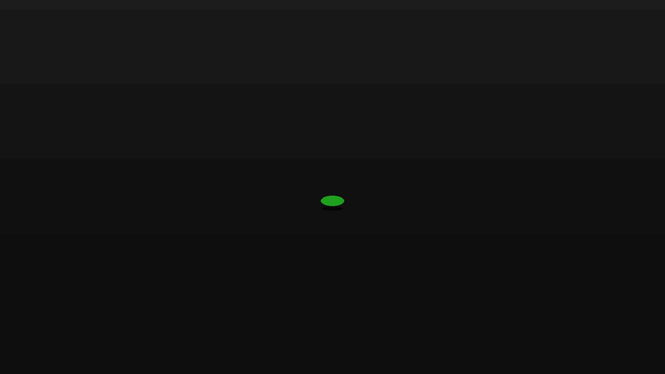
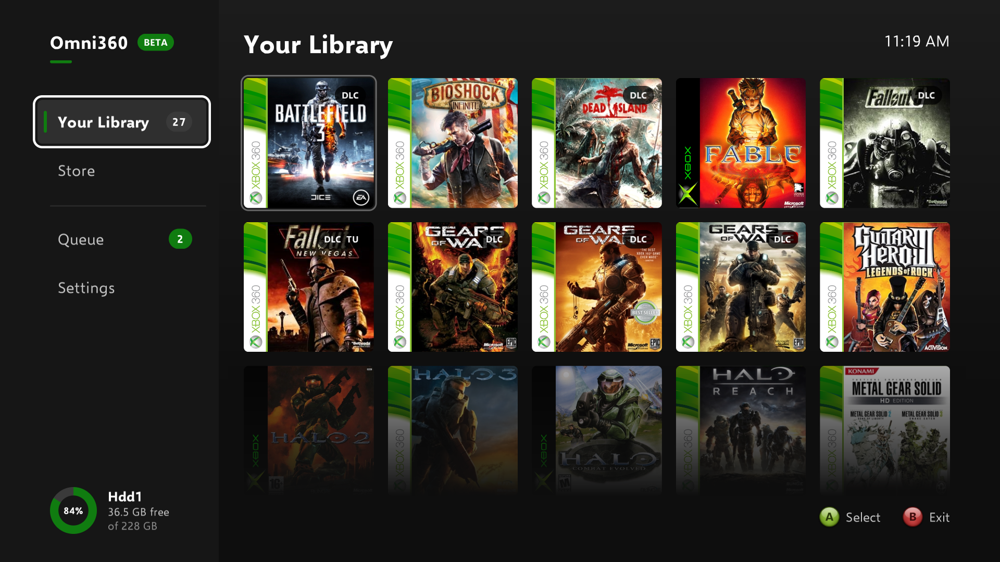
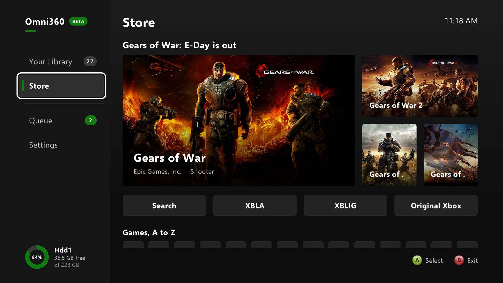
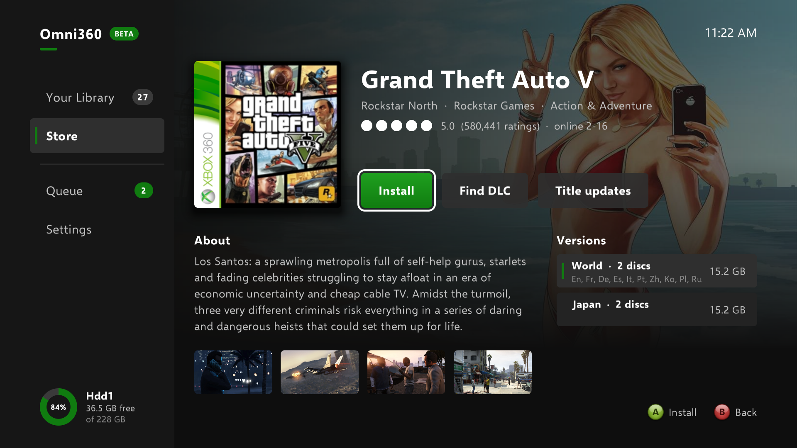
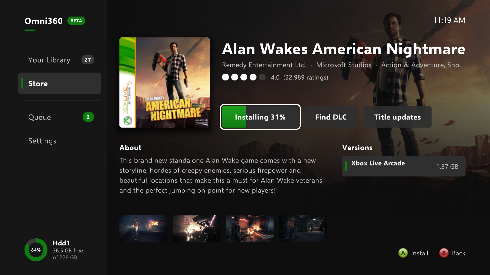
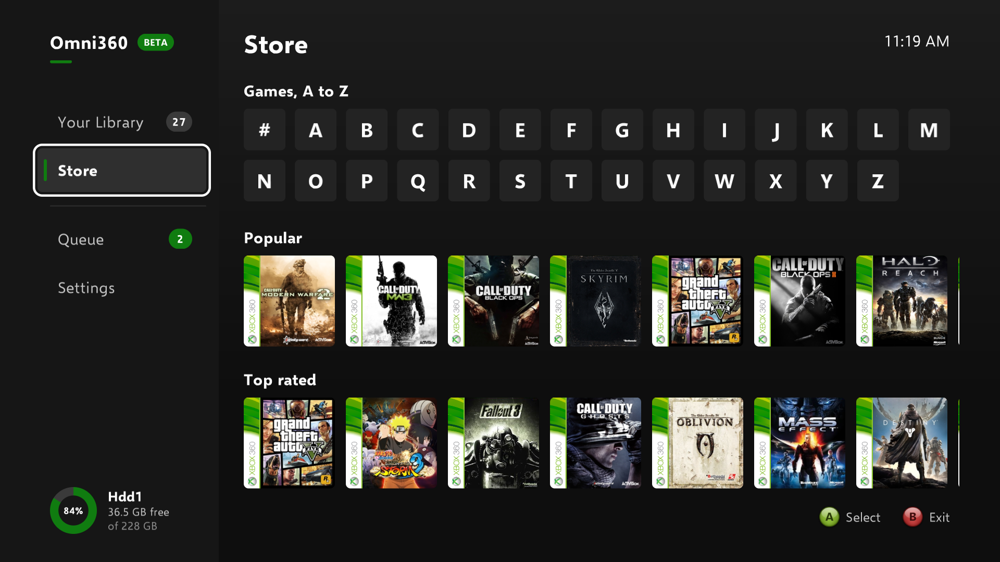
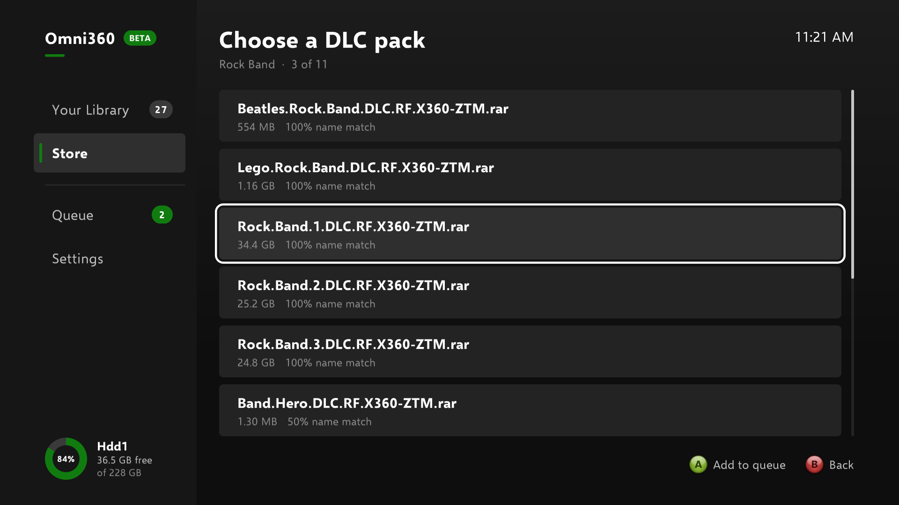
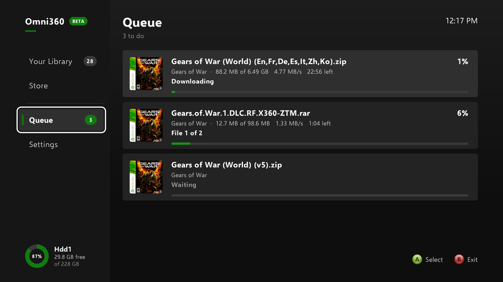
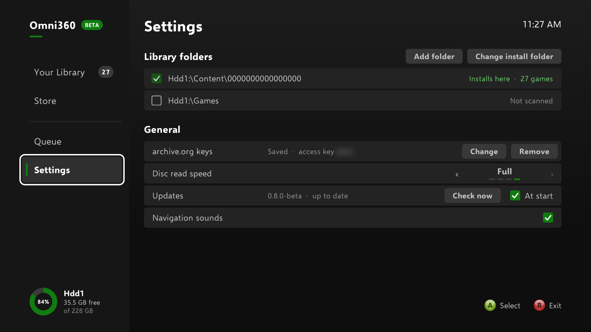

# Omni360

### Get games onto your modded Xbox 360, from the Xbox 360

Browse thousands of games, DLC and title updates, install them in the background, and play them right from Omni360 - or from the dashboard or Aurora. No PC needed once it's set up.

 

**[Quick start](#quick-start)** &nbsp;·&nbsp; **[What it does](#what-it-does)** &nbsp;·&nbsp; **[Screenshots](#screenshots)** &nbsp;·&nbsp; **[Docs](docs/docs.md)**

 

## Quick start

**You need:**

- A soft-modded (BadUpdate, ABadAvatar, PeerPressure) or hard-modded (RGH, JTAG) Xbox 360, connected to the internet. Ethernet is recommended.
- An archive.org account, and its IAS3 access key and secret key. Every collection Omni360 downloads from is marked private, so archive.org refuses downloads without them.
- Free space for installing games: the download and the installed game both, while it installs — around 7GB plus 3-8GB for a typical game. The download is removed once it's installed.

**Then:**

1. Download `Omni360.xex` from the [latest release](https://github.com/JustGillin/omni360/releases).
2. Get your archive.org keys at [archive.org/account/s3.php](https://archive.org/account/s3.php), logged in with your normal account. These are archive.org's official script-friendly credentials, the same pair their `ia` tool uses — not your password. Put them in a plain text file, `ArchiveOrgKeys.txt`, access key on line 1 and secret key on line 2. (Or type them in on the console, in Settings — painful with a controller, but it works.)
3. Copy `Omni360.xex` and `ArchiveOrgKeys.txt` into a folder of their own on the console, and launch it.

The [Setup Guide](docs/Setup%20Guide.md) covers the whole thing step by step.

<b>Choosing where things go</b>

 

Two optional `settings.txt` keys change where things go, and the games folder can also be changed on the console in Settings:

- `games-path:` — where games install, and where the library is scanned. Defaults to `Hdd1:\Content\0000000000000000`, where the dashboard keeps Games on Demand and arcade titles. Add more `games-path:` lines to scan more folders, such as `Usb0:\Content\0000000000000000` — the first is still where games install. See the Setup Guide.
- `xbla-path:` — where DLC, title updates, arcade games and indie games are written. Same default. (The name is inherited from X-Store, which used the same key.)

 

## What it does

Omni360 is a store and a library in one app on the console. **Your Library** shows every installed game, read straight from the hard drive, and plays them - or the disc in the drive - with **A**, and the **Store** lists about 1,500 Xbox 360 disc games, 740 Xbox Live Arcade games, 3,450 indie games and 500 Original Xbox games from archive.org, along with DLC and title updates for any of them - filtered by region, language, genre or rating, browsed by series, or found with a search. Everything downloads and installs in the background while you keep browsing, with disc games installed as Games on Demand, and a game disc in the drive can be copied to the hard drive the same way. Omni360 also keeps itself up to date, installing only releases signed with the project's key. Nothing downloads without you choosing it, and a popup says when each job finishes or fails.

**Status: beta (0.11.0-beta), working on real hardware.** Every kind of install has been run end to end on a modded console with a real library.

 

## Screenshots

   
  <b>Your Library</b>: every installed game, Xbox 360 and Original Xbox, with its DLC and title updates marked.

   
  <b>Store</b>: this week's featured games up top, then every game A to Z.

<table>
  <tr>
    <td width="50%"> <b>A game's page</b>: description, ratings, screenshots and every regional version.</td>
    <td width="50%"> <b>Xbox Live Arcade</b>: arcade games get the same pages, and show their progress as they install.</td>
  </tr>
  <tr>
    <td width="50%"> <b>Browse</b>: A to Z, or rows of Popular, Top rated and every genre.</td>
    <td width="50%"> <b>DLC</b>: find the packs for any game and pick the ones you want.</td>
  </tr>
  <tr>
    <td width="50%"> <b>Queue</b>: everything downloads and installs in the background.</td>
    <td width="50%"> <b>Settings</b>: library folders, your archive.org keys and updates, all on one screen.</td>
  </tr>
</table>

 

## Known limitations

- **Downloads are slow-ish** — about 3.5MB/s on average, so a game takes half an hour or more. archive.org's servers are the limit, not the console.
- **Some games aren't in the Store.** Games archived only as compressed RARs (in the `XBOX_360_*` items, such as the DiRT series and Deadpool) aren't listed, as the installer would have to unpack them first; uncompressed RARs, like BioShock Infinite's, install like any other game. A few dozen more aren't on archive.org at all.
- **An interrupted game install starts over.** Pieces resume within a session, but quitting the app mid-download removes what was downloaded.
- **A multi-disc game installed some other way** — from real discs, or another tool — can't be uninstalled by version from its Store page, since Omni360 can't tell which disc is which. Its own library entry still can be, if the Store hasn't got it.
- **A scratched disc can fail partway through a disc install.** Lower the disc read speed in Settings and try again.
- **Key entry** on the on-screen keyboard isn't masked.
- **DLC matching is deliberately loose** — it has to cope with release-group names like `Halo.1.Combat.Evolved.Anniversary...` and abbreviated display names like `CoD: World at War`. It scores candidates 0-100 on how much of the game's name appears in the filename, and penalises a missing number heavily so "Halo 3" doesn't offer "Halo 4". You always confirm the pack yourself.
- **Display names** are decoded as UTF-8 or UTF-16BE, whichever each package turns out to use; characters outside the BMP become `?`.

 

## How it works

<b>The library, the Store, installs, DLC and disc installs</b>

 

**The library** walks `{games folder}\{TitleID}\{ContentType}\*` and reads each title's ID, name and icon out of its STFS package header (`StfsParser.cpp`) — entirely offline. Covers come from xboxunity.net, or Xbox Live's box art where xboxunity has none, and are cached in `game:\Covers` (`CoverArt.cpp`).

**The Store's games are compiled in.** `tools/make_store_titles.py` builds `StoreTitles.h` from archive.org's Redump collection (the `microsoft_xbox360_*` items, one zip per disc), with title IDs from Redump's own datfile — a disc's serial *is* its title ID: "MW-2004" is publisher code `MW` (0x4D57) and title 2004 (0x07D4). It adds games the Redump collection lacks from the `XBOX_360_2` to `_6` set, gathers each game's discs into games and versions, and writes their labels, so the console only reads tables. Wallpapers, screenshots, descriptions and ratings come from Xbox Live's servers over plain HTTP (`HttpPlain.cpp`), and are cached in `game:\Store` (`StoreArt.cpp`).

**Installing a game** (`GameInstaller.cpp`) downloads the disc's zip in 32MB pieces over two connections, from whichever of archive.org's servers holding it is fastest. archive.org stalls both connections about once a minute, so a connection that goes silent for 10 seconds, or slows below 0.5MB/s, is dropped and its piece resumed where it stopped; one server failing repeatedly moves the download to the next. As the pieces land, the disc image is decompressed once to check its CRC and to note restart points; then it's converted to Games on Demand (`GodConvert.cpp`) straight out of the zip, so the 7-8GB image is never written out — only the parts of the disc the game uses, typically 3-7GB. The package gets the game's icon from Xbox Live. Each install is noted in `game:\Store\Installed.txt`, with the disc's media ID, so the Store can tell which disc of a multi-disc game is installed. A typical game takes 30-40 minutes to download and 5-10 to install.

**DLC and title updates** (`ArchiveOrgDLC.cpp`, `DownloadQueue.cpp`) send your keys as an `Authorization: LOW <access>:<secret>` header, look the game up by name in the collection's metadata, then read each matching archive's file table with a few small `Range` requests: RAR interleaves headers with each file's data, so that walks the chain one entry at a time; ZIP keeps a central directory at the tail, so one request covers it. Each file is downloaded through archive.org's `/download/{item}/{archive}/{path}` form, which serves the member already extracted, and written where the console expects it: DLC by its own `TitleID\ContentType\ContentID` path, lowercase `tu...` updates into `Content\0000000000000000\{TitleID}\000B0000\`, and uppercase `TU_...` updates into `{device}\Cache\`. Avatar-item packs (content type `00009000`) are filtered out.

**Disc installs** (`DiscWorker.cpp`) watch the tray, read the disc that goes in, and convert it to Games on Demand the same way, reading ahead from the drive at full speed (or the speed set in Settings). An Original Xbox disc is read only where its files are, as the 360's drive refuses its security ranges.

 

## Check out X-Store too

Omni360 began as a modified version of [X-Store](https://github.com/951261/X-Store) by 951261, and X-Store is still a great app in its own right, now with Internet Archive support of its own. It's well worth trying alongside Omni360.

 

## Building it yourself

You need the official Microsoft Xbox 360 XDK and Visual Studio 2010 (`XboxTLS2.vcxproj` targets `Platform=Xbox 360` directly — this is **not** buildable with the open free60/libxenon toolchain). Sourcing the XDK is on you. See [`COMPILING.md`](COMPILING.md), and [`RELEASING.md`](RELEASING.md) for publishing a version people can update to.

 

## Supporting Omni360

Omni360 is free, and always will be: no ads, no tracking, nothing locked away. The best ways to help are free too:

- **Star the repo** so more people find it.
- **[Report a bug](https://github.com/JustGillin/omni360/issues)** or a game that won't install. It's how things get fixed.
- **Tell someone** with a modded 360 who'd use it.

If you'd like to chip in anyway, you can sponsor it on GitHub. It's entirely optional, and every feature stays free either way.

 

## License

AGPL-3.0, inherited from the original X-Store project (see `LICENSE`). Vendored components keep their own licenses: BearSSL (`SSL/`, MIT), zlib (`zlib/`, zlib license), cJSON (`cJSON.c/.h`, MIT), dmc_unrar (`dmc_unrar/`, GPL-2.0-or-later), the Selawik font (OFL). A modified version you distribute must stay under AGPL-3.0 with copyright notices preserved and source available to anyone you give the binary to.

### Credits

Omni360 is a modified version of [X-Store](https://github.com/951261/X-Store) by 951261, released under AGPL-3.0; this section is its notice that it has been modified (AGPL-3.0 section 5(a)). Most of the application has since been rewritten, but X-Store's code is still at its foundation: the TLS wrapper around BearSSL (`XboxTLS.cpp/.h`), the HTTPS client (`downloadFile.cpp`), DNS (`dns.cpp`), URL and text helpers (`parsing.cpp`), drive mounting (`driveMount.c`), the log console (`OutputConsole.cpp`) and the on-screen keyboard (`Keyboard.cpp`). Several of those files carry `PROGRAMMER : 951261` headers. Those headers are copyright notices, and AGPL-3.0 requires them to survive - rename the product as much as you like, but leave them, and this section, in place.

Game data comes from [Redump](http://redump.org) (title IDs, by disc serial), [xboxunity.net](https://xboxunity.net) (covers) and Xbox Live's own servers (art, details and icons); the games themselves from the archive.org collections named above.

Built with [BearSSL](https://bearssl.org) (TLS), [zlib](https://zlib.net) (inflate), [dmc_unrar](https://github.com/DrMcCoy/dmc_unrar) (RAR unpacking), [cJSON](https://github.com/DaveGamble/cJSON) (JSON) and [stb_image](https://github.com/nothings/stb) (JPEG and PNG decoding, public domain).
