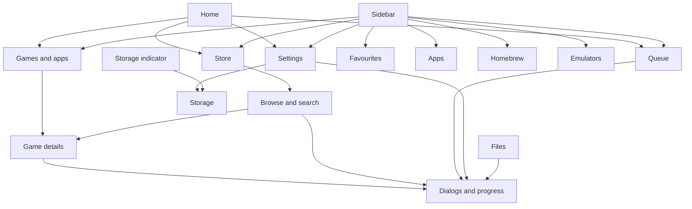

# Omni360 UI audit

## Goal

Make every screen and interaction feel like one deliberate product. Controller actions must be visible in a consistent footer at the bottom of the screen wherever those actions are available. The footer uses the Xbox button badge and a clear action label; it must not hide an available action or imply an unavailable one.

For dialogs, the audit will check whether action hints stay visible at the screen bottom while the dialog is open, and whether labels, ordering, focus, confirm, and cancel behavior remain consistent.

## First-pass screen map

This map comes from `ShellPage` and the renderer/input branches in `src/GameListUI.h`, `src/GameListUI.cpp`, and `src/main.cpp`. Runtime exploration will add nested screens and conditional states.

## Audit record

| Area | Current evidence | Audit status |
| --- | --- | --- |
| Home | Shelf and all four top-nav icons checked on full frames | Done; see "Library walkthrough" |
| Library / Favourites | Games grid (paging), sidebar, Options dialog, Favorites grid and Options | Done; empty/loading states not reachable (every list has items) |
| Apps / Homebrew / Emulators | Apps and Homebrew sidebar and grid checked; Emulators page is hidden when no Emulators folder is set | Done, except Emulators (would need a setting change) |
| Store | Landing rows, XBLA picker and full list, Homebrew page and item, search with results, installed and uninstalled game pages, DLC / Title updates / Versions | Done; see "Store walkthrough". XBLIG, Original Xbox, Collections, Publishers lists and error/loading states not reached |
| Queue | Recently installed tiles, footer, Y (Night mode) toast | Done for what exists; active, paused, error and empty states need a real download (source only) |
| Settings | All five sections (General, Assets, Storage, Language, About) and every row type walked live; pickers opened and cancelled | Done; see "Settings walkthrough". Keyboards, Unpair/Scan, Set now/Check now/Run test/Re-sync not opened |
| Storage | Overview, Free up space, Partial downloads, Leftover DLC and updates, Measure again, Files (drive list, inside a drive, Y menu, X marks) | Done; Files delete/copy/move confirmations not run |
| Dialogs | Exit, System (BACK), toasts, every confirmation reached, Files menu, Settings and Store pickers | Done; see "Queue and dialogs walkthrough". Progress overlays not reached |
| Blocking screens | Startup, status, progress, launch, and night renderers | Verify which accept input and what their footer should show |

## Where it stands (2026-11-23)

Batches 1-9 are done (b17-b33); each has a "for review" table under "Fix first" saying what changed. Every finding below carries its status: **Fixed (bN)** names the build that fixed it, **Fixed (shortening)** is the shared text-shortening fix (fix-first item 2), **OK** is an observation with nothing wrong, **No change** was looked at and kept on purpose, **Partly fixed** says in the batch notes what's left, **Open** is still to do, **Later** belongs to a bigger project.

Still open:

| Finding | Where |
| --- | --- |
| Store search: white panel before the keyboard draws - the system keyboard (vk.xex) draws it; Omni360 has no hook into it | Store walkthrough |
| Indie game's own cover in the Queue: built (b30), not seen - the indie game had left Recently installed | Batch 9 follow-up |

Later, as projects of their own: simple first setup, library sections/filters/saved views, Storage sorted by size, a system-info page, cover flow / accent colours / themes, "See all" tiles at the end of Store rows, retranslating reworded lines.

## What each walkthrough records

For every screen and meaningful state, record:

- Entry path and focused item or region.
- Every accepted controller action and its footer label.
- Back/cancel behavior and where focus returns.
- Empty, populated, loading, success, and error states where applicable.
- Dialog stacking, safe cancellation path, and progress feedback.
- Text clarity, localization fit, hierarchy, spacing, and any visual inconsistency.
- OBS capture and source renderer/input function for each finding.

Destructive or long-running actions will be documented at their confirmation step and canceled during discovery. They will only be executed when needed to inspect a result and explicitly authorized.

## Shared conventions to check first

1. Footer placement, order, badge scale, label length, and behavior at 640x480 and 1280x720.
2. Consistent meanings and wording for A, B, X, Y, Start, bumpers, and triggers.
3. Focus and selection visibility, including sidebar-to-content transitions.
4. Dialog placement, action hints, cancel behavior, and nested dialogs.
5. Loading/progress, empty/error states, success feedback, and toast timing.
6. Text hierarchy, capitalization, localization, truncation, and line wrapping.
7. Content density: avoid a second line that merely restates the title. Keep a subtitle only when it adds orientation, status, or an explanation the user needs to choose safely; prefer contextual help over permanent explanatory copy.
8. Plain language: labels and help text should read naturally to someone who isn't technical. Avoid jargon (paths, partitions, "re-sync", "measure", internal names) unless the user needs that word to act.
9. Clipped or hard-to-read text: anything cut off mid-word, overflowing its box, too dim, or too small at projector size.

### User direction (2026-11-20)

- Wording should not be too technical, and the same thing should be called the same thing on every screen.
- Don't overuse subtitles. Example: the Storage screen's left-hand buttons (Free up space, Partial downloads, Leftover DLC and updates, Measure again, Browse files) don't need subtitles; the name alone should be obvious. Counts or sizes that help decide may stay, but only where they add something.
- Versions should present the same way as the title update and DLC modals.
- Flag clipped text and hard-to-read text everywhere.

## Findings

### Live footer findings

These were observed on the connected Xbox through the OBS Windowed Projector on 2026-11-20. The bridge was active; navigation used short D-pad, A, B, X, and Y taps.

| Status | Screen/state | Observed footer | Expected / behavior | Evidence |
| --- | --- | --- | --- | --- |
| Closed | Home, top navigation focused on Games + Apps | A Open; B Exit is absent in the live frame | Source assembles A Open and B Exit. Runtime and source disagree; verify the active build and footer clipping/layout. | Live observation; `src/main.cpp` Home navigation hint branch near 12150; **not reproduced on full frame 2026-11-20: A Open, B Exit** |
| Closed | Apps, sidebar focused | No action hints visible | Source should expose A Select and B Home on sidebar focus. B/return behavior is not obvious to the user. | Live observation; `src/main.cpp` sidebar-focus hint construction; **not reproduced: A Select, B Home** |
| Closed | Homebrew, sidebar focused | A Select only; no B Home | B does return to Home, confirmed by pressing B. Add the missing B Home hint. | Live observation; `src/main.cpp` sidebar-focus hint construction; **not reproduced: A Select, B Home** |
| OK | Games grid | A Play, X View game, Y Options, B Home, LB/RB Page | Complete mapping observed for this populated grid state. | Live observation |
| OK | Games sidebar focus | A Select, B Home | Complete mapping observed; moving down immediately changes the page (Favorites, then Apps). | Live observation |
| OK | Apps grid | A Start, B Home | Complete mapping observed; all apps fit, so no page hints are needed. | Live observation |
| OK | Home game shelf | A Play, X View game, B Exit | Complete mapping observed on initial and latest Home frames. | Live OBS frames |
| Fixed (b11) | Game details: Versions | Opens as a right-side panel that leaves the detail screen visible behind it; footer shows A Choose, B Done | User requests a modal presentation consistent with DLC and title updates. Adopt one shared centered modal treatment and the same bottom-screen footer placement for these related actions. | Live OBS; user direction 2026-11-20 |
| Fixed (b26) | Game details: community note | Long text continues beyond the right edge and ends mid-word | Wrap text within the content column, or provide an intentional truncation/expand affordance. | Live OBS, Warrior Within |
| Fixed (b25) | Game details: disabled DLC/title update actions | Focus can land on dimmed actions; on Title updates the footer contains only B Back and Y Versions | Disabled controls should not receive focus, or should explain why unavailable; ensure the footer always maps all actions actually available in the current focus state. | Live OBS, Warrior Within |
| OK | Manage game | A Manage game opens a full-screen content selection view; A Select, Y Select all, B Back; no items selected during audit | Bottom mapping and return path are clear. Preserve the safety copy about saves and make later removal confirmation explicit. | Live OBS, Warrior Within |
| Fixed (b11) | Dialog footers: Options, DLC, title updates | Hints are placed near the bottom of each centered dialog, leaving substantial screen area below them | Keep the modal content centered, but move controller hints into a shared footer anchored to the screen bottom. This applies the user’s rule literally across dialogs. | Live OBS, Games Options + Sonic DLC/title updates; user direction 2026-11-20 |
| Fixed (shortening) | Sonic DLC dialog | Four installed item labels visibly end early (for example, `Additional Episode "Shadow Bos.`); dialog says 7 items installed | Provide enough row width, wrap names, or ellipsize consistently while preserving a way to read the complete name. | Live OBS, Sonic the Hedgehog (Xbox 360) |
| Fixed (b11) | Sonic title updates dialog | Centered modal reports no installed updates and offers Find more online; A Select, B Back | Presentation matches the DLC modal. Move hints to the shared screen-bottom footer. | Live OBS, Sonic the Hedgehog (Xbox 360) |
| OK | Sonic details (Xbox 360) | Description wraps cleanly; screenshots and a related-games shelf are visible; footer A Play, B Back, Y Versions | The layout and body copy are legible at this projector size. Use a 360 title for representative detail flow; original Xbox titles have distinct compatibility notes. | Live OBS, Sonic the Hedgehog |
| OK | Sonic Manage (Xbox 360) | Lists the game and installed DLC with full item names; footer A Select, Y Select all, B Back; empty selection maintained | Same interaction as the original Xbox title. User can distinguish game vs DLC by type label and storage location. | Live OBS, Sonic the Hedgehog |
| OK | Store landing | Featured game and category tiles; footer A View game, B Home, Y Search | Footer is complete and screen-bottom. Category names are legible. | Live OBS |
| OK | Store search keyboard | Dedicated keyboard screen, blank field, helper text says partial names search every list; LB/RB switch left/right, LT Symbols, RT Accents, stick Caps, X Backspace, Y Space, Done; screen-bottom A Select, B Back | Strong explicit control mapping. Verify any text clipping at alternate resolutions later. | Live OBS; search canceled empty |
| Fixed (b16) | Queue, Recently installed | Four items initially; X Remove immediately removed focused Marvel Nemesis item from the displayed list, count changed from 4 to 3; no confirmation shown. B Home available. | Footer maps actions clearly. Review whether Remove should say "Remove from queue" or prompt, depending on whether it only dismisses the recent entry or uninstalls the content. | Live OBS; one item removed from the Queue display with user authorization |
| Closed | Settings: General, Archive.org keys row | Focus moves to Change; footer shows A Select only; pressing B returns Home | Always show B Home while available, including when a child control is focused. | Live OBS; no setting changed |
| OK | Settings: General, Navigation sounds row | Footer shows A Turn off and B Home; contextual help for the selected row appears immediately above footer | Helpful contextual description and clear action wording. Keep shared footer complete as focus moves to other row types. | Live OBS |
| Closed | Home top navigation | Games + Apps and Queue showed A Open only; Store and Settings showed A Open and B Exit | Top-navigation footer should be consistent across destinations if Exit is available in all those states. | Live OBS; multiple nav items; **not reproduced: all four icons show A Open, B Exit** |
| Closed | Storage: Free up space | A Select, Y Select all, Manage game; no B Back hint. B does return to Storage overview. The list explains saves are kept and DLC/update removal. | Keep B Back in the screen-bottom footer across all selection-list screens. | Live OBS; no items selected or removed; **not reproduced: A Select, Y Select all, Manage game, B Back** |
| Fixed (b17) | Settings: Assets | Re-sync library is the sole setting action; page otherwise empty | Add one-sentence explanation of the scan and its effects so the page feels intentional. | Live OBS; re-sync not activated |
| OK | Settings: Storage | Lists enabled scan paths, content type, item counts, and not-scanned paths; Manage storage and Add path controls | Useful at-a-glance status; screen-bottom A/B hints appear when content is focused. Validate path text at smaller resolutions. | Live OBS; no path changed |
| OK | Storage manager overview | Free space, per-drive usage, color legend, Free up space, Partial downloads, Leftover DLC and updates, Measure again, Browse files; A Select, B Back | Clear overview and task labels. Keep destructive work behind a visible review/confirmation step. | Live OBS |
| Fixed (0e985de, b11) | Storage: partial downloads confirmation | Centered "Delete partial downloads?" dialog opens with Delete focused; no dialog-specific button hints; underlying A/B hints are dimmed | Default focus to Cancel, show Delete/Cancel button mappings in the shared screen-bottom footer, and keep the safety copy readable. | Live OBS; no delete performed |
| Closed | Storage: file browser | Dual-pane browser explains Left/Right pane switching and X/Y actions at the top, while screen-bottom footer shows only A Open | Put every currently available controller action in the screen-bottom footer, including B Back and X/Y when active. Avoid relying on top-of-screen helper copy alone. | Live OBS; no files changed |
| Fixed (b17) | Storage task labels | "Measure again" is paired with "Reads every drive again"; the user says the label sounds odd | Use a direct label such as "Rescan drives" or "Refresh storage info"; remove repeated subtitles that merely restate labels elsewhere. | Live OBS; user direction 2026-11-20 |

### Settings walkthrough (2026-11-20, Claude)

Path: Settings opens from Home's top navigation; sidebar is General, Assets, Storage, Language, About. B from any content row goes to Home. No settings were changed; every picker was cancelled with B.

| Status | Screen/state | Observed | Expected / suggestion |
| --- | --- | --- | --- |
| Fixed (shortening) | Help line, bottom-left, all sections | Long help text is cut off mid-word, with a stray period: Storage › Add path "…on the hard drive or a USB d."; General › Set clock "A wrong clock makes sec."; General › FTP server "…while Omni360 is ."; Language › Clock "…where the language is spoken - left a."; About › Speed test "…to see what slows downl." | Wrap to two lines or shorten the copy. The truncation drops the last word and adds "." even mid-word; fix that too (ellipsis at a word boundary). |
| Fixed (b16) | Carousel rows: General › Disc read speed, Install disc games as; Storage › path type; Language › Clock | Left/right is the only way to change the value, but no footer hint says so. Disc read speed shows only B Home; Install disc games as and Clock show A Select, B Home, though A does nothing obvious. Path rows show A Stop scanning/Scan. | Show a ◀▶ "Change" hint whenever a carousel is focused. A should behave and read the same on every carousel, or not be offered. |
| Fixed (b16, b19) | Language list | Active language (English US) shows "A Turn off"; others show "A Turn on" while the help says "A switches Omni360 to this language". Rows use checkboxes though only one language can be on. | Radio-style marks; label "Use". No A hint on the language already in use. |
| Fixed (b18) | Settings › Storage: Add folder / Downloads picker | Going back up from a folder leaves the previous dialog drawn dimmed behind the new one ("Add Folder / Hdd1:" ghost with its own faded A Select / B Back). Seen twice; persists in still frames. | Clear the old layer when going back a level. |
| Fixed (b11) | Dialogs in Settings (Add folder, Downloads go here, Sign in at start) | Dialog hints sit inside the dialog while the page footer stays visible underneath, dimmed but readable ("A Select, B Home" plus the old help line): two footers. | One footer at the screen bottom showing the dialog's actions; hide the page footer (same rule as the existing dialog-footer finding). |
| Fixed (b17, b19) | About › Version info | Focus gives no outline, only slightly brighter text; nearly invisible. Footer B Home only. | Skip the row (nothing to do on it) or give it the standard focus outline. |
| Fixed (b17, b25) | Folder picker, inside a folder | Focus starts on "Use this folder", so a second A press picks the folder by accident. B climbs one level at a time (up to four presses to leave); footer only says "Back". | Start focus on the first subfolder. Offer a one-press close (e.g. Y Cancel) and show it in the footer. |
| Fixed (b16, b17) | Settings › Storage, first row | Footer "A Select" while the button reads "Change" and help says "A picks another path". | Footer label "Change". |
| Closed | Settings › Storage, path rows | "A Stop scanning" / "A Scan", while help says "A adds it to Emulators". Source (`src/main.cpp` ~12543) also uses "A Remove" for paths the user added, which looks the same as unticking. | One verb pair ("Scan" / "Stop scanning") with matching help. Make clear when A removes the folder from the list rather than unticking it. |
| Fixed (b17) | Settings › Storage wording | "Manage paths" header, "Add path" button, "Add Folder" picker title (title case). Raw paths shown ("HDD1:\Content\0000000000000000", "Usb0:\Apps"); "HDD1:" vs "Hdd1:" on different rows. Drives are "Hdd1:/Usb0:" in the picker, "HDD1" on the sidebar ring, "Hard drive / USB drive 1" on Storage. | Say "folder" everywhere, sentence case ("Add folder"). Use the friendly drive names everywhere; normalise casing. |
| Fixed (b17) | Settings › Storage, "Drives" header | Heading holds only a "Manage storage" button that opens a page titled "Storage", inside Settings › Storage: "Storage" names three things. | Drop the "Drives" heading, or rename the button (e.g. "Open storage"). |
| Fixed (b17) | Downloads picker | Lists title-ID folders ("415407D7", "E0000437AE7C668C", "0000000000000000"); title "Downloads go here". | Jargon. Title "Download location"; start at the drive root or label known folders. |
| Fixed (b17) | Settings › Storage status | "1 found" on Homebrew; other rows say "4 games", "3 apps". | "1 app". |
| Fixed (b17) | General › archive.org keys | Label starts lowercase; status "Saved · access key dikO." looks truncated. | "Archive.org keys"; status "Saved" (or "dikO…" if the partial key matters). |
| Fixed (b16, b17) | General › PC helper | "Scan" button (finds the PC again) reuses the folder "Scan" word; Unpair and Scan both show generic "A Select". | Rename "Find PC"; footer names the action ("Unpair", "Find PC"). |
| Fixed (b17) | General › Sign in at start | Picker (Off, then each profile) marks the current choice only by focus, no tick. | Tick the current option, as Language does. |
| Fixed (b25) | General › FTP server | Status shows address and password in plain text ("ftp://<console IP> · sign in as xboxftp / xboxftp"). | Useful but technical. Consider "PC file access (FTP)" with the details in the help line only. |
| No change | General, focus style | Single-control rows outline the whole row; multi-control rows (PC helper, Set clock, archive.org keys) outline only the button. | Acceptable; consider also lightly highlighting the row. |
| Fixed (b17) | Assets | Now has help text (earlier "page otherwise empty" finding is partly fixed). "Re-sync library" row with a "Re-sync" button repeats itself; "Re-sync" and "Assets" are jargon; help says "disk" where elsewhere it's "drive". | Section "Library"; row "Refresh game list", button "Refresh"; "drive" not "disk". |
| Fixed (b17) | Language › Clock | "Clock" under Language means the time format. | "Time format" (12/24-hour); consider moving it to General beside the clock setting. |
| Fixed (b17) | Language › Refresh | "Refresh" alone is vague. | "Reload languages". |
| Fixed (b17) | About | Version appears twice ("0.20.0-beta · up to date" and "Omni360 0.20.0-beta · Kernel 2.0.17559.0"); help says "Asks GitHub…"; "Kernel" is jargon. | One version row; "Console software 2.0.17559". |
| Fixed (b17) | Help lines generally | Many repeat the footer ("A picks another path", "A stops scanning it", "A switches…"). | Drop button wording from help text; the footer carries the action. |
| Fixed (b17) | Return focus | Settings → B → Home lands on the game shelf, not the Settings icon. Storage → B → Settings › Storage returns to "Manage storage", and dialogs return focus to their button (both good). | Return to the Settings icon in the top nav. |

Working as expected: sidebar focus shows A Select, B Home; checkbox rows show A Turn on/off, B Home; Storage overview shows A Select, B Back.

### Library walkthrough (2026-11-20, Claude)

Covers Home, Games, Favorites, Apps, Homebrew and the sidebar storage ring. The five P1 footer findings from cropped frames were rechecked and marked Closed above. Nothing was launched, changed or toggled.

| Status | Screen/state | Observed | Expected / suggestion |
| --- | --- | --- | --- |
| Fixed (shortening) | Apps grid, tile with no art | Label reads "HDD Compatibili." (cut mid-word plus a stray period, the same truncation bug as the Settings help lines); focused it scrolls as "HDD Compatibilit". | Fix the shared truncation: ellipsis at a word boundary, or wrap. |
| Fixed (b19) | Emulators | Page is hidden when no Emulators folder is set (`PageHidden()`, `src/main.cpp` ~4213), so it never appears, yet Settings › Storage help says "A adds it to Emulators". | Either mention in Settings where Emulators shows up, or show an empty Emulators entry ("No emulators found" plus how to add one), as Favorites does. |
| Fixed (b17) | Favorites › Y Options | Opens with focus on "Remove from favorites", so A, A removes it with no confirmation. | Start focus on Rename, or make removal undoable. |
| Fixed (b20) | Apps / Homebrew grids | Footer "A Start, B Home"; Y does nothing (correctly not shown). Games offer Options (rename, favourite, view); apps don't. | Fine if intended; otherwise offer Y Options (at least Rename). |
| Closed | Favorites spelling | UI says "Favorites" everywhere; check the en-ca pack uses one spelling throughout. | One spelling per language. |
| No change | A verb by context | "Play" for games, "Start" for apps, "Open" in top nav, "Select" in sidebar. | Acceptable; confirm "Start" vs "Play" is deliberate. |
| Fixed (b18) | Sidebar or top nav focused | The last-focused tile keeps a grey/light outline while the sidebar or nav has the white one: two outlines on screen. | Make the remembered position clearly weaker than focus (no border, or much fainter). |
| Fixed (b16, b17) | Sidebar storage ring | Footer "A Select" (it opens Storage); ring labelled "HDD1", Storage says "Hard drive" with "Hdd1"; USB is "USB drive 1" beside "Usb0". | Footer "A Storage"; one friendly drive name everywhere, consistent numbering. |
| Closed | Games grid, long focused title | Scrolling title is hard-cut at both tile edges ("mer 40,000: Spac"); reads as clipped in a still. | Fade the edges, or pause at the start before scrolling. |
| Fixed (b25) | Games grid paging | "LB RB Page" shows even when one direction can't page. | Minor; consider dimming the side that doesn't apply. |
| Fixed (b17) | B from a library page | Returns Home with focus on the shelf, not the Games + Apps icon; re-entering always opens Games, even after leaving from Favorites. | Return focus to the nav icon used to enter. |
| Fixed (b19, b23) | Home over a light wallpaper | "CONTINUE PLAYING" (small green caps) and white top-nav labels are low contrast on a near-white wallpaper (Soulcalibur II). | Stronger scrim or shadow behind the top band and caption. |
| Fixed (b19, b26) | Free up space | "Manage game" hint uses a grey arrow glyph that doesn't read as a controller button; small white mark in the right panel's top-right corner; "MGS 2 AND 3" in all caps. | Standard button glyph; check the panel corner. Name casing comes from metadata (optional). |
| Fixed (b17, b19) | Storage overview | "Partial downloads: 1 item, 0 B" reads oddly. While measuring, "Measuring your drives..." appears both under the page title and as the Measure again subtitle. | Hide empty partials or word it plainly; show measuring status in one place. |

### Store walkthrough (2026-11-20, Claude)

Nothing was downloaded, installed, queued, launched or changed.

| Status | Screen/state | Observed | Expected / suggestion |
| --- | --- | --- | --- |
| Fixed (b16) | Store › XBLA › All (full list); search results | Footer says "B Store", but B goes back to the A-to-Z picker. | "B Back", or name where B really goes. |
| Fixed (b11) | Game details from Home (X View game) with Versions open | Opening the Versions panel squeezes the page behind it: title "Sonic .", info "SEGA · Sega · .", rating "3." (truncation bug). | Modal overlay that never re-lays out the page (see the comparison below). |
| Fixed (b18, b25) | Homebrew item page (e.g. 3DOx) | "A Install" installs straight away; page title is the row name "Emulators", not the item; bottom line "Installs to Hdd1:\Emulators\3DOx". | Item name as title; plain destination ("Installs to your hard drive") or none. |
| Fixed (b16) | Store game page, Title updates button focused | Footer "A Find title updates" but A opens the installed-updates dialog; button says "Title updates". | Footer matches the button. |
| Fixed (b17) | Title updates › Find more online, nothing found | "Neither XboxUnity nor archive.org has a title update for this game." Green pill "OK", no footer hints. | "No updates found for this game."; "A OK" at the bottom; same button style as other dialogs. |
| Fixed (b18) | DLC dialog, installed item focused | Focus is only a slightly lighter fill, no white outline (the button gets one); no scroll cue though "7 items" don't all fit, and the "Installed" header scrolls away. | Standard white focus outline; scroll cue or "x of 7". |
| Fixed (b11) | Every centered dialog (DLC, Title updates, DLC search, no results) | Dialog hints inside the dialog plus the dimmed page footer ("A Find DLC  B Back  Y Versions") still visible: two footers. | One screen-bottom footer with the dialog's actions (extends the existing dialog-footer finding). |
| Fixed (shortening) | Store landing rows; Homebrew emulators row | Truncation bug: "Call of Duty.", "Grand Theft.", "Need for Sp.", "Amiga360 Refresh 2026 - Feature Edition (Ami." | Fix the shared truncation. |
| Closed | Full list and search, focused tile | Scrolling name hard-cut at both edges ("0 Day Attack on Eart", "rs Racing Transfor"). | Fade the edges or pause before scrolling. |
| Fixed (b17) | Category names | Tiles "XBLA", "XBLIG"; page title "Xbox Live Arcade". Jargon, and inconsistent. | One plain name everywhere: "Arcade", "Indie games", "Original Xbox", "Homebrew". |
| Fixed (b25) | Genre naming | "Action & Adventure" (hero, game page) vs "Action and adventure" (row header). | One form. |
| Fixed (b25) | Full list header vs A-to-Z picker | Picker "#", header "All games · 0-9"; opened from "All" the header still names a letter. | Same symbol in both; letter shown only as position. |
| Fixed (b17, b18) | Category page (XBLA) | Subtitle "743 games from archive.org"; bottom half empty; no "Y Search". | "743 games"; add Y Search. |
| Fixed (b17, b25) | Homebrew page | Subtitle "From the ConsoleMods repo, as Aurora's Homebrew Store lists it"; a row named "Homebrew" inside the Homebrew page; footer "A View" vs "View game" elsewhere. | Drop the subtitle; rename the row; one verb for A. |
| Fixed (b20, b25, b26) | Homebrew rows | Off-screen text tiles have no name until scrolled in; most lack art; two identical "DashLaunch" tiles. | Always show names; tell duplicates apart (version or author). |
| Fixed (b20) | Puzzle and trivia row | No art on any tile; "Scene It Bright Lights! Big Screen!" twice in a row. | Remove duplicates or label editions. |
| Fixed (b25) | Store landing, A label | "View game", "Browse all", "Browse", "View collection", "View" on different tiles. | Varying by target is fine; "Browse" vs "Browse all" should be one word. |
| Later | Store landing rows | No "See all" at the end of Collections, Popular or genre rows. | Optional "See all" tile. |
| Fixed (b17) | Store game page info line | "SEGA · Sega · Action & Adventure" repeats publisher/developer in different case. | Show one when they match. |
| No change (b21) | Store game page layout | Description is a narrow left column on Sonic the Hedgehog, a full-width line on Sonic Generations. | One layout. |
| Fixed (b17) | Store game page buttons | "Find DLC" beside "Title updates" (verb vs none); both dialogs are titled with the game name, not "DLC" / "Updates". | Parallel labels; title each dialog by what it is. |
| Fixed (b17) | DLC dialog | Subtitle "7 items installed, 2.21 MB. Manage on the game's page removes DLC." is two ideas; rows end in "Hdd1". | "7 installed · 2.21 MB"; drop the removal tip; friendly drive name or none. |
| Fixed (b25) | DLC › Find more online | Raw file name "Sonic.The.Hedgehog.DLC.RF.X360-ZTM.rar", "100% name match"; long subtitle about archive.org. | Cleaned-up name and size; "Best match" instead of %; subtitle "Items you already have are skipped." |
| No change (b18) | "Find more online" button | Label pushed right by blank space, as if an icon is missing. | Align like other buttons, or add the icon. |
| Fixed (b21) | Versions rows | Tiny dim language codes "En, Ja, Fr, De, Es, It" (Japan row has none); checkbox meaning unclear. | Spell out or drop languages; clear "Installed" tag. |
| Fixed (b16) | Store game page, More like this focused | Footer still shows "Y Versions" for the parent game. | Hide Y there. |
| Fixed (b29 check) | Uninstalled store page | No Y Versions before install; picking a version before installing a multi-version game not checked. | Check a multi-version game before install. |
| Open (system keyboard) | Search keyboard | Blank white panel for ~1 s before the system keyboard draws. Results: "Search · 21 games · 1 of 21", footer "A View game  B Store  Y Search again  LB/RB Page". | Dark placeholder if possible. |
| Fixed (b23) | Back from a related game | Search → Sonic → More like this → Sonic Generations, then B ×3 landed on Home, skipping the earlier pages. | Confirm the intended back history. |
| Fixed (b17) | Home › X View game | Opens details inside Games + Apps; B goes to the Games grid, not Home. | Return to Home when opened from Home. |

Good: focus returns to the button that opened a dialog; B from DLC search returns to the DLC dialog; landing footer complete ("A View game  B Home  Y Search"); full list shows "1 of 743" with LB/RB and LT/RT hints.

#### Versions vs DLC vs Title updates

| | Versions (Y) | DLC (Find DLC) | Title updates |
| --- | --- | --- | --- |
| Placement | Right-side panel, ~45% wide, full height; page stays visible (and gets squeezed on the library page) | Centered dialog over dimmed page | Centered dialog over dimmed page |
| Title | "Versions" | Game name | Game name |
| Subtitle | None | "7 items installed, 2.21 MB. Manage on the game's page removes DLC." | "No title updates are installed for this game." |
| List | Region in bold + tiny language codes, size, checkbox | "Find more online" button, "Installed" header, rows with icon, name, size · Hdd1 | "Find more online" button only (when none installed) |
| Focus marker | White outline + green check on chosen version | White outline on button; rows only a lighter fill | White outline on button |
| Footer | "A Choose  B Done" inside the panel | "A Select  B Back" inside the dialog, page footer still visible | Same as DLC |
| Default focus | Current version | Find more online | Find more online |
| Close | B "Done" | B "Back" | B "Back" |

**Recommended single design:** one centered dialog for all three. Title says what it is ("Versions", "DLC", "Updates") with the game name small; one short subtitle only for a count or size; same row style (name left, size right, status tag in one place); the same white focus outline on rows and on "Find more online" as the first row; scroll cue when it overflows; one screen-bottom footer with the dialog's actions and the page footer hidden; B always "Back"; the page behind dims and never re-lays out.

### Queue and dialogs walkthrough (2026-11-20, Claude)

Nothing was removed, deleted, exited, launched or changed. Two checkboxes were ticked only to reach confirmations, then cancelled and cleared.

| Status | Screen/state | Observed | Expected / suggestion |
| --- | --- | --- | --- |
| Fixed (0e985de) | **Every confirmation** (`ShowConfirmUI` → `ShowAlertUI` → `RunAlert`, `src/GameListUI.cpp`) | Focus opens on the confirm button: seen on "Delete partial downloads?" (Delete), Leftover and Manage game "Remove from your drives?" (Remove). Confirmed in source: `RunAlert` starts at button 0 and `ShowConfirmUI` puts the confirm label first, so Files delete, Stop downloading/installing, Remove keys and Remove folder do the same. A double A press destroys data. | Open on Cancel; fix once in `RunAlert`/`ShowAlertUI`. Replaces the single partial-downloads finding. |
| Fixed (0e985de, b11) | Exit Omni360? (B on Home) | Buttons "Turn off", "Restart", "Exit"; focus on Exit; no Cancel; no hints, only the dimmed page footer. Turn off and Restart have no second confirmation. B cancels. | Add Cancel and start there; show "A Select, B Cancel". |
| Fixed (b17) | Exit dialog wording | "Exit goes back to the dashboard. Restart and Turn off do that to the console." Title asks about exiting, but two buttons power-cycle the console. | Title "Leave Omni360" or "Power"; "Go back to the Xbox dashboard, restart the console or turn it off." |
| Fixed (b17) | Leftover DLC and updates › Remove | "This removes Marvel: Ultimate Alliance 2 and frees 157 MB." reads as removing the game; detail "Saves are kept. A game's DLC and updates on the same drive are removed with it." doesn't fit leftovers. | "This removes 2 DLC and 1 update for Marvel: Ultimate Alliance 2 (157 MB)." Leftover-specific note or none. |
| Fixed (b16) | Queue, Y | Arms Night mode (turns the console off when downloads finish) with no footer hint and no confirmation. | Show "Y Night mode" while something downloads; confirm or show a clear armed state. |
| Fixed (shortening, b17) | Queue toast | "Nothing is downloading / Night mode turns the console off when the queue empties. It." (truncation bug; full text ends "It's empty already."). | Wrap toast text to two lines. |
| Fixed (shortening) | Queue recent tiles | Unfocused names "Left 4 Dead." (drops the "2", looks like another game), "Marvel: Ulti.", "Naruto: Ris."; focused bold label overhangs the tile's left edge. | Truncation fix; never drop a sequel number. |
| Fixed (b16) | Queue recent tiles, X | Footer "X Remove, B Home"; X clears the entry instantly. X means "View game" on identical-looking Home tiles. A does nothing. | "X Clear from list" (it doesn't uninstall) or move to Y; consider "A View game". |
| Fixed (b20) | Manage game, loading | "Loading..." with the sidebar drawn and no footer; then the layout jumps to full width without the sidebar. | "B Back" while loading; same layout before and after. |
| Fixed (b11, b17, b19) | Home, BACK | Opens a "System" panel (IP, Signed in, Kernel, Omni360, FTP, temperature bars). Its hints are inside the panel bottom-left ("B Close, X Fahrenheit"), unlike every other dialog. BACK isn't hinted anywhere; does nothing on Settings or Games. | Hint it or document it; one footer position for all dialogs; "Kernel" → "Console software"; "X Show °F". |
| Closed | Home, START | Nothing on the shelf; on a disc tile it starts a disc install (source, `HomeTileAction`). | Make sure the disc tile shows a START hint. |
| Fixed (b17) | Queue header | Subtitle "3 installed" repeats the "Recently installed" row below. | Drop it when only recents exist. |
| Fixed (b19) | Queue vs Storage | Queue shows "Marvel: Ultimate Alliance 2" with box art as recently installed; Storage lists it as "No game installed · 2 DLC · 1 update". | Label DLC/update installs as such in Queue ("· 2 DLC"). |
| Fixed (b17) | Queue empty state (source) | "DLC and title updates you choose will wait here while they download." Games queue too. | "Games, DLC and updates you download wait here." |
| Fixed (b19) | Partial downloads confirmation | "This frees 0 B."; "A download started again begins from the start." | Hide the action at 0 B; "If you download it again, it starts over." |
| Fixed (b19) | Manage game from Leftover | Help still says "Remove a single DLC or update, or just the game and keep its extras." with no game present; the same sentence repeats as the confirmation detail. | Context-specific help; don't repeat it in the confirmation. |
| Fixed (b19) | Selection wording | Storage lists "A Deselect", Files "X Unselect"; Files' Y menu has "Select all" but no clear. | One verb ("Deselect"); add "Clear selection" to Files. |
| No change (b19) | Leftover / Free up space footer | "Manage game" glyph is grey and is actually START. | Standard START glyph. |
| Fixed (b21) | Files › Y menu | Title is the item name ("Apps") even with focus elsewhere; Copy uses a file icon, Move and New folder share a folder icon; Delete has no icon or caution styling; Copy/Move offered when the other pane shows only Drives. | Title "1 item"; distinct icons; caution Delete; disable Copy/Move without a target folder. |
| Fixed (b19) | Files, marked row | Tick replaces the folder icon. | Keep the type icon; show the tick separately. |
| Fixed (b17) | Files, inside a drive | Footer complete ("A Open, X Select, Y Actions, B Back"); top helper still clipped ("Y acts on what's selecte"); drives "Hdd1:", "HddX:", "Usb0:"; title "Files" vs button "Browse files". | Friendly drive names (HddX is jargon); drop or shorten the helper now the footer is complete. |
| Fixed (b18) | Files, inactive pane | Keeps a grey outline: two outlines on screen. | Fainter, as in the library finding. |
| Fixed (b17) | Measure again (pressed once) | Footer drops to "B Back"; status shows in header and row. | Status in one place. |
| Fixed (b17); no change (b20) | Return paths | Walking the sidebar down to the storage ring passes Homebrew and switches page, so B from Storage lands on Homebrew. View game from Home → B lands in the Games grid; details highlight "Games" in the sidebar. | Return to where the user came from; the ring shouldn't switch pages when passed over. |
| Fixed (b16, b17) | Game details footer | "A Play, B Back, Y Versions": B in the middle (last elsewhere); button "Manage" vs hint "A Manage game"; "SEGA · Sega". | B last; match labels; dedupe publisher/developer. |
| Fixed (b26) | Manage game / Leftover right panel | Small white mark at the panel's top-right corner. | Check the corner rendering. |

#### Dialogs seen

| Dialog | Default focus | Buttons | Hints | B |
| --- | --- | --- | --- | --- |
| Exit Omni360? | **Exit** | Turn off, Restart, Exit (no Cancel) | None; dimmed page footer | Cancels |
| System (BACK on Home) | Nothing focusable | None | Inside panel, bottom-left: "B Close, X Fahrenheit" | Closes |
| Night mode toast (Queue, Y) | n/a | n/a | n/a; body clipped | Times out |
| Delete partial downloads? | **Delete** | Cancel, Delete | None; dimmed page footer | Cancels |
| Remove from your drives? (Leftover, Manage game) | **Remove** | Cancel, Remove | None; dimmed page footer | Cancels, selection kept |
| Files › Actions (Y) | Copy to the other side | Copy, Move, Rename, Delete, New folder, Select all | Inside dialog plus dimmed page footer | Closes |

Three different hint patterns: confirmations show none, menus and pickers show them inside the dialog, and the System panel puts them bottom-left.

## Fix first

Ordered by risk, then reach:

1. **Confirmations open on Cancel**, including Exit (add Cancel). One change in `RunAlert`/`ShowAlertUI` covers every delete, remove, stop and power action. **Done in 0e985de**, checked on the console.
2. **Fix the shared truncation** (word boundary + ellipsis, or wrap): settings help lines, toasts, tile names, store rows, the squeezed Versions page. Dozens of instances; some mislead ("Left 4 Dead."). **Done:** XUI's ellipsis style cut mid-word and drew "…" as a single full stop in Selawik. `UiFont::DrawText` now shortens the text itself, ending at a word with "..." (checked on the console: "…to see what slows..."). Places that are simply too narrow (the Versions page) still need layout work under item 3.
3. **One dialog component and one footer rule**: centered dialog, page footer hidden, the dialog's own actions in a single screen-bottom footer. Make Versions, DLC and Title updates the same dialog (see the comparison under Store). **Done (b11, checked on the console):** every dialog drawn by `RunAlert` (confirmations, choices, DLC, Title updates, pickers, Files actions), the progress dialog and the System panel now put their hints in the screen's footer, over a dark band that hides the page's own footer. Button dialogs gained hints: "A Select, B Cancel", or "A <label>" for a lone button. Versions is no longer a side panel: Y opens the same list dialog as DLC (game name, "Install gets the ticked one.", tick on the chosen version, languages and size under each). Still open from the comparison: titling the three by what they are ("Versions", "DLC", "Updates") rather than the game name, and the DLC subtitle wording - both need copy decisions (item 5).
4. **Footer labels that match what the button does**: "B Store" that goes back, "A Find title updates", carousels with no ◀▶ hint, "A Turn off" on the active language, Queue "X Remove", Queue "Y" Night mode. **Done (b16, checked on the console):** Store sub-pages say "B Back"; the game page says "A Title updates", hides "Y Versions" on More like this, and puts B last; Settings value rows show a new D-pad ◀▶ "Change" icon and A no longer acts on them (Install disc games as used to toggle); Settings buttons name their action in the footer ("A Change", "A Unpair", "A Run test"...) instead of "A Select"; the language in use has no A hint, the others "A Use"; Settings footer adds "LB RB Section"; Queue X reads "Clear from list"; the sidebar storage ring says "A Storage". Queue "Y Night mode" already shows while something downloads. New from this pass: on a Settings › Storage folder row, Left changes the folder type, so the sidebar can only be reached from a row without a value (P2, focus trap).
5. **Plain names, used the same everywhere**: drives ("Hard drive", "USB drive 1" instead of Hdd1/HDD1/Usb0/HddX), store categories (no XBLA/XBLIG), folders not paths, "Kernel", "Re-sync", "Assets", raw file names and match percentages.
6. **Trim subtitles and help lines** that repeat the label or the footer (Storage's left buttons, Queue "3 installed", Homebrew and category subtitles, DLC subtitle).
7. **Return focus to where the user came from** (nav icons, Home after View game, the storage ring not switching pages).

### Batch 1 for review (b17, 2026-11-21)

Fix-first items 5-7 plus open P2s, in one build. Naming choices are the user's (2026-11-21); drives keep their real names (Hdd1:, Usb0:) and only get consistent casing. **Checked on the console by Claude:** Settings › Storage rows, folder-row Left, Storage buttons, return to the Settings icon, View game from Home then B. The rest is in the code and built, for the user to look at first.

| Where | What changed |
| --- | --- |
| Everywhere | "HDD1:" and "hdd1:" now show as "Hdd1:" (also "Usb0:", "HddX:"); the sidebar ring says "Hdd1" |
| Store | Tiles and page titles "Arcade" and "Indie games"; category subtitle "743 games"; Homebrew page subtitle gone |
| Game page | Button "DLC" beside "Title updates"; "SEGA · Sega" shows once |
| DLC / Title updates / Versions dialogs | Titled "DLC · Game", "Title updates · Game", "Versions · Game"; DLC subtitle "7 installed · 2.21 MB"; online search "Find DLC · Game"; help lines no longer say what A does |
| Title updates, nothing found | "No updates found for this game." |
| Settings › General | "Archive.org keys" (status just "Saved"); PC helper "Find PC"; disc speed help without "left and right change it"; Sign in at start ticks the current choice |
| Settings › Library (was Assets) | "Refresh game list", button "Refresh", "drives" not "disk" |
| Settings › Storage | "Manage storage" is a row with an "Open" button (no "Drives" heading); "Folders", "Add folder"; homebrew row says "1 app"; help lines drop "A picks…"; Left on a folder row's first type goes to the sidebar |
| Settings › Language | "Time format" (was Clock); "Reload" (was Refresh) |
| Settings › About | "Console software 2.0.17559" replaces Version info (the version is on Updates) |
| Folder pickers | Inside a folder, focus starts on the first subfolder, not "Use this folder"; "Download location" title |
| Storage | Left buttons have no subtitles except counts; "Rescan drives"; partials with 0 B say "1 item" |
| Leftover DLC and updates › Remove | "This removes the DLC and updates for <game> and frees 157 MB."; no "Saves are kept" note |
| Exit (B on Home) | Title "Leave Omni360", "Go back to the Xbox dashboard, restart the console or turn it off." |
| System panel (BACK) | "Console software"; X "Show °F" / "Show °C" |
| Queue | No "3 installed" subtitle when only recents; empty state "Games, DLC and updates you download wait here."; Night mode toast reworded |
| Favorites › Y | Opens on Rename when the game is a favourite |
| Messages | One-button messages show "A OK" instead of "B Continue" |
| Speed test | Progress "Step 6 of 7" (no "B stops it"); when the helper is 30%+ faster than archive.org the verdict says to download through it |
| Return focus | B from a page opened from the top nav lands on that icon; a game opened with X on Home goes back to Home |
| Translations | en-ca regenerated; the machine-translated languages keep their old wording for changed lines until retranslated |

Not done in this batch: Cancel while pairing waits (needs the wait to stop mid-request), telling a PC-side timeout from a No, Manage game's loading screen (it blocks), the folder picker's leftover layer and one-press close, Files menu icons, Home BACK hint, Y Search on category pages, Language radio marks.

#### Found during batch 1 review (user, 2026-11-21)

| Status | Screen/state | Observed | Expected / suggestion |
| --- | --- | --- | --- |
| Fixed (b18) | Settings › PC helper › Find PC | Takes over the whole screen: "Looking for your PC" progress (`ScanProgress` → `RenderStatusFrame`), then the result as a full-screen message (`ShowMessageUI`), in `ScanForPcHelper` (`src/main.cpp`). | Run it in a centered dialog over Settings, as other dialogs are: progress, then the result, in the same dialog with its hints in the screen footer. Pairing ("Allow it on your PC", `PairPcHelper`) uses the same full-screen frames and should move with it. |
| Fixed (b18) | Find PC › nothing found | Text on the "No helper found" result is cut off. The message ("Make sure Omni360 Helper is running on a PC on the same network as this Xbox.") and the detail line ("If it is, allow it through…") are drawn on single lines by the status frame, so the ends are cut. | Wrap the message and detail. Moving it into a dialog (above) should fix it; check both lines fit at 640x480. |

### Batch 2 for review (b18, 2026-11-21)

**Checked on the console by Claude:** Find PC (search progress and "No helper found" as dialogs over Settings, full text wrapped, focus back on Find PC), and the folder picker (going into Hdd1: and back leaves no leftover layer; focus starts on the first subfolder).

| Where | What changed |
| --- | --- |
| Settings › PC helper › Find PC | Runs in a dialog over Settings: a progress bar with "Checked 24 of 253 addresses", then the outcome as an OK dialog. No button hint while it searches, since nothing can be pressed |
| Pairing (after Find PC finds a new PC, or Pair) | "Talking to your PC" and "Allow it on your PC" in the same dialog; the bar shows the time the PC has left to answer; Paired / Not paired as an OK dialog |
| Full-screen messages everywhere | The message wraps to up to three lines and the detail to two, and the card grows to fit, instead of cutting the end off with "..." |
| Folder pickers (Add folder, Download location) | Every level draws over the page it was opened from, so going back up leaves no dimmed copy behind |
| Store category pages (Arcade, Indie games, Original Xbox) | Y Search, as on the Store's front page; B from the results comes back to the category |
| List dialogs (DLC, Title updates) | Installed rows that can't be picked now get the white focus outline too |
| Grids, Home shelf, Files | The remembered position (while the sidebar, top nav or other Files pane has focus) is a much fainter outline, so there's one clear focus on screen |

Not changed: the Homebrew item card already carries the item's name (the header shows its kind); "Find more online" is indented to line up with the labels of rows that have icons.

### Batch 3 for review (b19, 2026-11-21)

**Checked on the console by Claude:** BACK hint on Home, Settings › About skipping the Console software row, Language's round marks.

| Where | What changed |
| --- | --- |
| Home | Footer adds "BACK System" (new BACK button icon: START's twin, arrow pointing left) |
| Home over light wallpapers | Stronger shade behind the top bar and the "Continue playing" line |
| Settings › Language | Languages use round marks (one at a time) instead of checkboxes |
| Settings rows that only tell you something | Passed over by up/down (Console software in About) |
| Queue › Recently installed | A DLC or update install is named "DLC: Game" / "Update: Game", so the game's box art doesn't read as the game installing (new installs only; ones already listed keep their names) |
| Files | A ticked row keeps its folder or file icon, turned green, beside the green edge |
| Storage › Partial downloads | With nothing downloaded yet, the confirmation says so instead of "This frees 0 B" |
| Manage game from Leftover DLC and updates | Note says the game isn't installed and these are its DLC and updates; the remove confirmation says "Saves are kept." instead of repeating the note |

Already covered, no change: Night mode has its own screen when armed (the indicator the finding asked for); scrolling names already fade at the edges; the Emulators help now says scanning shows it in Emulators; Files says "Deselect" like Storage; the grey glyph on "Manage game" is the controller's own START button.

Still open after batch 3: Cancel while pairing waits and telling a timeout from a No (need the wait to stop mid-request); Manage game's blocking loading screen; Files menu icons and a caution style for Delete (no icons for them yet); Y Options (Rename) on Apps and Homebrew; walking the sidebar to the storage ring switches pages; Versions rows' language codes; Store data duplicates (Scene It, DashLaunch); description layout differences between game pages.

### Batch 4 for review (b20, 2026-11-21)

**Checked on the console by Claude (after a restart that picked up the bridge fix):** Apps shows "Y Options"; Y opens a dialog with Rename; Rename opens the keyboard with the current name, and B leaves it unchanged; Manage game shows "Loading..." as a dialog over the game page, then its list. The Store row de-duplication was not looked at on screen.

| Where | What changed |
| --- | --- |
| Apps, Homebrew, Emulators | Y Options: Rename, and Use the original name once renamed; footer shows "Y Options". The grid shows the new name and re-sorts, as games do |
| Manage game (from Storage or a game page) | "Loading..." is a small dialog over the page it came from, not a screen with the sidebar that then jumps layout |
| Store front page rows | One tile per name, so regional copies (Scene It) no longer sit side by side |

Looked at, no change: walking down the sidebar to the storage ring shows each page on the way, and B from Storage returns to the ring with the page above it, which is how the sidebar works everywhere; the two DashLaunch tiles are different apps (one is the Bad Update Safe build), and the "..." shortening now shows the difference; Versions' language codes come pre-joined with other notes from the catalog generator, so changing them belongs in the generator.

New from this check (P2): the rename keyboard's help says "the game's files keep theirs" for apps too; it should say "its files" or use the item kind.

Still open: Cancel while pairing waits and telling a timeout from a No; Files menu icons and a caution style for Delete; Versions' language codes (generator); description layout differences between game pages.

### Batch 5 for review (b21, 2026-11-21)

**Checked on the console by Claude:** Versions on Sonic the Hedgehog reads "English, Japanese and 4 more · 6.74 GB" (and the info line shows "SEGA" once); Files' Y menu shows the new Copy and Move icons and a red bin on Delete. Pairing could not be tried: it needs a PC helper that isn't paired yet.

| Where | What changed |
| --- | --- |
| Pairing ("Allow it on your PC") | B Cancel works while it waits: each wait runs on its own thread and the dialog shows "B Cancel"; cancelling goes back to Settings quietly (the PC's prompt runs out on its own) |
| Pairing, nobody answers on the PC | The helper now answers 410 when its prompt runs out with no answer, and the console says "Nobody answered on your PC." rather than "Pairing wasn't allowed" - **needs the helper rebuilt** (helper/pairing.go); an older helper still reads as a No |
| Files › Y menu | New icons: Copy (two pages), Move (arrow out of a page), Delete (a bin, always red) |
| Versions dialog | Redump's language codes as words: up to three named, then "and N more" |
| Rename keyboard on an app | "Only Omni360 shows this name - its files keep theirs." (games keep "the game's files") |

Looked at, no change: Copy/Move while the other side shows only drives already explains when chosen ("Open the folder it should go into on the other side."); a game page's description is narrow beside screenshots and full width without them, which is intended.

New from this check (P2): over a light wallpaper (Sonic the Hedgehog's sky), the small green "CONTINUE PLAYING" is still hard to read even with batch 3's stronger shade - it needs a text shadow or a darker plate, not more gradient.

#### Found while looking at Valkyrie (user, 2026-11-21)

| Status | Screen/state | Observed | Expected / suggestion |
| --- | --- | --- | --- |
| Fixed (b23) | Apps scan | Valkyrie (`Hdd1:\Apps\Valkyrie`) isn't listed, though it sits beside the user's other apps. Cause, confirmed over XBDM: the folder has no `default.xex` and two .xex files, `valkyrie.xex` and its own `FtpDll.xex`. `VisitApps` (`src/FolderGames.cpp`) only takes a folder with `default.xex`/`default.xbe` or exactly one .xex; with several it treats the folder as a group of programs (emulator cores) and looks inside its subfolders instead. | With several .xex, take the one named like the folder (`Valkyrie` → `valkyrie.xex`), case-blind. Possibly also skip names that look like libraries (`*Dll.xex`). Keep the several-programs rule otherwise. |
| Fixed (b23, b25, b27) | Disc install (START on the disc tile) | Starts at once: `StartDiscInstall` (`src/main.cpp`) only asks first when reinstalling or for a compilation disc. Valkyrie's "Apotheosis" page, seen on the console with Darksiders in the drive: the box art large on the left; the game's name; four labelled facts in a row - Title ID (545107E6), Region (NTSC-U/NTSC-J), Game size (6.5 GB), Disc (XGD - 1 of 1); a "Where it goes" card ("Your library, under Games - saved to this console's hard drive. Play it from the Library, no disc needed."); then one button, "Rip to GOD", with "Needs 6.7 GB, 93.2 GB free" beside it. The user likes it, especially the region and disc number. | A preview before queueing, in Omni360's dialog style: cover and name; region, size and "Disc 1 of 2" (the disc probe already has the title ID, media ID and disc number - `DiscWorker.h`; region would come from the XEX header's game-region flags, not read yet). The disc count comes from the same place Valkyrie likely reads it, the XEX's execution info, and can be wrong for a game whose second disc is installed rather than swapped: Valkyrie shows Halo 4 as "1 of 1", while the Store catalog (`StoreTitles.h`) has Halo 4 (World) as Disc 1 and Disc 2 under title ID 4D530919. Cross-check: when the catalog has more discs for the title ID than the header says, show the catalog's count; where it goes in plain words and the space it needs against what's free; the install format (Games on Demand or folder); "A Install", B to back out. Skip the raw title ID, or keep it small. The same dialog could front Store installs. |
| Fixed (b23) | Storage › Browse files, on an .xex | A does nothing on an .xex file, so a program can't be started from the file browser. Aurora can, which the user finds handy for testing builds. | A on an .xex (and .xbe) offers to start it, with the same "leaving Omni360" confirmation as starting an app; footer "A Start" on those rows. |

### Batch 6 for review (b23, 2026-11-21)

**Checked on the console by Claude:** Apps now lists Valkyrie (13 apps, was 10 - also XeXMenu and the second Simple 360 NAND Flasher, on Usb0:, which the same rule had missed); Files shows "A Start" on an .xex (not pressed: with nothing downloading it starts at once, as an app does); "Continue playing" and the game's name read over Sonic's light wallpaper; Store › GTA V › More like this shows Bully once, and B from a related game (GTA IV) comes back to GTA V on the tile it was left by. The install preview wasn't seen: it needs a game disc in the drive.

| Where | What changed |
| --- | --- |
| Apps, Homebrew, Emulators scan | A folder with several .xex and no default.xex counts as an app when one .xex is named after the folder (Valkyrie\valkyrie.xex beside FtpDll.xex) |
| Storage › Browse files | A on an .xex or .xbe starts it (with the usual question first if downloads would stop); footer "A Start" |
| Disc install (START on the disc tile, or Install from disc) | A preview first, titled with the game's name: "Disc 1 of 2 · 6.5 GB · Games on Demand" (or just size and format for one disc) and "Installs to Hdd1:, leaving 86.7 GB free. Play it from your library without the disc." - A Install, B Cancel. The disc count is the larger of the disc's own and the Store catalog's, so Halo 4 should read "of 2". Not shown after a reinstall or compilation question, which already asked |
| Home | The caption, the game's name and the nav label have a soft dark shadow, so they read over light art |
| Store game pages | B after More like this goes back through the games opened from it, focus on the tile left by; More like this shows each name once |

Still open: region on the install preview (the game's header has it; not read yet) and the cover in that dialog; the PC helper finding the PC again on its own; dimming the side of "LB RB Page" that can't move; Homebrew tiles' names at the row's edge.

### Batch 7 for review (b24, 2026-11-23): motion polish

Ideas from Valkyrie (see `docs/comparison.md`).

**Checked on the console by Claude:** b24 boots to Home; moving along the recents row cross-fades straight from Catherine's wallpaper to Crysis 3's; Apps shows "H", "V" and "X" letter tiles (HDD Compatibility Fixer, Valkyrie, X-Store), including the focused one with its name scrolling; Y → Options → B comes back to Apps with no fade and the ring where it was. Not caught on camera: the glide and the page fade themselves. A capture takes longer than the 150 ms they last, so they need eyes on the TV.

| Where | What changed |
| --- | --- |
| Everywhere with a focus ring | The ring glides to the next thing over about 150 ms instead of jumping, including between the sidebar and the grid, and between Home's nav row and recents. It follows a tile that grows, a row that glides or a dialog card that rises, with no lag. It snaps into place when a page or dialog opens, or when frames were more than 250 ms apart |
| Moving between pages | A page fades in from the background over about 170 ms: Home → Games, sidebar steps between pages (only the content fades, the sidebar stays), opening a Store game page. Not when closing a dialog, nor between Games / Favourites / Apps, which are one page |
| Focused names | The focused tile's name (library, Store rows, Queue and anywhere else that scrolls long names) and Home's game name and nav label start at about half brightness and brighten as the ring arrives. Home's green caption stays steady |
| Home wallpaper | Once the focus rests, the games either side are fetched even when this game's wallpaper is already on screen, so stepping along the row cross-fades straight to the next wallpaper rather than through the background |
| Library (Apps, and games whose icon couldn't be read) | A tile with no cover and no icon shows its name's first letter, large, on one of six muted colours picked from the name, instead of a blank grey square |

To check: does the glide feel right at 150 ms (`FOCUS_GLIDE_TAU` in `GameListUI.cpp`)? Is the page fade welcome when stepping down the sidebar, or too much? Do the letter colours suit the rest of the page?

### Batch 8 for review (b28, 2026-11-23): the rest of the open list

Copy choices settled first (all as recommended): the FTP address alone on its row, "0-9" for the numbers tile, tidied DLC file names with "Best match", "Browse" on every Store tile and "View app" on Homebrew.

**Checked on the console by Claude:** Games' footer draws LB faint on the first page and both bumpers bright partway down a Homebrew row; Store shows "Action and adventure, Fighting" on the featured game, a "0-9" tile with "A Browse 0-9", and "A Browse" on All; Homebrew says "A View app" and its Emulators row, cut off by the footer, now has names ("Amiga360 Refresh 2026 - Feature..."); Warrior Within's page steps Play → Manage and back past the greyed-out DLC and Title updates; Settings › FTP server shows only "ftp://192.168.68.73"; Add folder from two levels deep closes in one press of Y; Free up space has its scrollbar beside the list and no mark on the panel; the console log shows the PC helper scan starting by itself a minute after the paired helper went quiet. Not seen: names on tiles half-scrolled into a row (they only show mid-glide), the helper actually being found (no helper was running), the longer synopsis on an Original Xbox page (built in b26 after that page was checked).

| Where | What changed |
| --- | --- |
| Footers with "LB RB Page" (Home, Games, Apps, Homebrew, Store lists) | The bumper that would only run into the first or last item is drawn faint |
| Store › Homebrew | Tiles half-scrolled into a row show their name, cut at the row's edge; a row the footer cuts off shows as many lines of each name as fit; footer "A View app" |
| Store game page (Original Xbox games) | Left and right skip the greyed-out DLC and Title updates buttons; without screenshots the description gets up to eight lines instead of three, so players' reported issues can be read through |
| Settings › General › FTP server | The row shows just the address; "Sign in as xboxftp / xboxftp." starts its help line |
| Folder pickers (Add folder, Download location) | Y Cancel leaves the picker from however deep you are; B still goes up a level |
| Homebrew item card | "Installs to Emulators on Hdd1:" instead of the folder's path; "by ..." now translatable |
| Store front page and game pages | Genres from the catalog read like the Store's rows: "Action and adventure", not "Action & Adventure" (English only) |
| Store A to Z | The numbers tile says "0-9", as the list it opens does; All's hint is "Browse", like the category buttons |
| DLC › Find more online | Names tidied: "Sonic The Hedgehog DLC RF X360" rather than "Sonic.The.Hedgehog.DLC.RF.X360-ZTM.rar"; the closest one is marked "Best match" instead of every row showing a percentage. Two files that tidy to the same name keep their file names |
| Disc install preview | The regions the disc plays in ("NTSC-U/PAL", or "Region free"), from the XEX's security info or the XBE's certificate; the game's cover at the left of the card. **b27, after the user saw it:** in three groups instead of one run - "Disc 1 of 2 · Region free", then "7.69 GB · Games on Demand", then where it goes, smaller and dimmer. Seen on the console with Halo 4 (cancelled, nothing installed) |
| PC helper | When the paired helper has been quiet for a minute and nothing is downloading, the console looks for it on the network by itself (as Find PC does), at most every ten minutes. Find PC waits for that scan if it's running |
| Storage › Free up space, Leftover | The list's scrollbar sits beside the list; it was under the right-hand panel, all but a white dot at the panel's corner |
| Home and Games footers (b28, the user's call) | BACK and START sit together at the start - "BACK System, START Install to hard drive, A Play, X View game, B Exit" on the disc tile - instead of START between X and B and BACK after it. BACK is first on Home everywhere; the disc tile in Games puts START first too |
| PC helper (PC side) | Rebuilt (Release/dist/helper) with the "Nobody answered on your PC" timeout from batch 5 |

Already done, found while checking: B Home shows on Settings buttons; "A Remove" on a folder you added has its own word and a confirmation; the DLC dialog has ▲/▼ when it overflows; Files has "Clear selection" and no clipped helper line; Rescan drives shows its status once; the Home disc tile shows START.

### Batch 9 for review (b29, 2026-11-23): the screens the first pass didn't reach

Walked on the console first: Indie games, Original Xbox, Collections, a publisher (Activision), Filter and sort, version picking on an uninstalled game, the Queue with a real download (0 Gravity Y3030, an indie game, 91.8 MB - installed, kept) and the Emulators page (Hdd1:\Emulators ticked, looked at, unticked again). Fine as they were: picking a version before installing (007: Blood Stone - Y Versions shows, the tick moves, Install gets it), Collections and publisher lists, Filter and sort.

**Checked on the console by Claude:** Queue's recent tile for the indie game reads "0 Gravity..." (was "DLC: 0 Gravity Y3030"); Indie games says "3,458 games"; LT is faint on the first game of All, as LB is; an installed indie game's page shows "Installed" with no A hint and no "No details found" line; the Store's H list shows "Installed" on Halo 3; a letter list with unavailable games shown says "With games you can't download"; the Store's Popular row scrolls the focused name; Settings' help line wraps to two lines. Not seen (needs another download): the Queue row's new wording and the game page's "A View in the queue".

| Where | What changed |
| --- | --- |
| Queue, an arcade or indie game downloading | The row is titled with the game's name, not "0 Gravity Y3030.rar" under "0 Gravity Y3030"; a DLC pack's file name is tidied as in Find more online |
| Queue status line | "Downloading (89%)" instead of "Step 2 of 2: File 1 of 1 (89%)" - the bar's segments already show the step; a pack of several files says "Downloading file 2 of 5" |
| Queue › Recently installed | An arcade or indie game no longer gets "DLC:" in front of its name |
| Store game page while it's queued or installing | Footer "A View in the queue", and A goes there (was "A Install", which only showed a toast); once installed, no A hint where there's nothing to play |
| Indie game pages | No "No details found for this game" under the name - the description already says why |
| Store lists (A to Z, collections, publishers, search) | Games in your library show the "Installed" pill, as the Homebrew rows do |
| "LT RT Letter" | The trigger that can't go further is faint, as LB RB is |
| Store category pages | "3,458 games", "1,092 games the 360 can run" |
| Letter lists with Filter's "Show games you can't download" on | Subtitle "With games you can't download" (was "Missing shown") |
| Store front page rows | The focused game's name scrolls, as everywhere else, instead of ending in "..." |
| Versions dialog | Only the chosen version has a mark; the others had a disc icon that read like a second choice |
| Emulators / Apps / Homebrew, empty | "Get some from Store › Homebrew, or copy a program's folder into the one above." (was the folder rule, and not translatable) |
| Settings help line | Wraps to two smaller lines when one won't hold it, instead of cutting the end off |

#### Batch 9 follow-up (b32, 2026-11-23)

**Checked on the console by Claude:** Popular shows "Installed" on Black Ops II, also with the row cut off by the foot of the page; the FTP server's help fits in two lines; the Queue rows read "Downloading (17%)" and "Downloading file 5 of 26 (16%)" on your Modern Warfare 3 game and DLC, with the DLC titled "Call of Duty Modern Warfare 3 DLC RF X360". Both downloads were paused for the deploy and resumed after.

| Where | What changed |
| --- | --- |
| Store front page rows | "Installed" on games in your library, as the lists have; its label shows as long as the pill itself is on screen (also on Homebrew rows) |
| Queue, an indie game | Its own LaunchBox cover on the row and in Recently installed, the indie banner until it comes |
| Queue, a paused download (b33) | Keeps its percentage and bar instead of emptying, and the file keeps it too ("progress=331"), so a paused download still shows how far it got after the app restarts. Checked on the console with the Modern Warfare 3 DLC: 33% paused, 33% after a relaunch. On resuming it starts its count again from the pieces already there |
| Settings › FTP server | Shorter help: "Sign in as xboxftp / xboxftp. Copy files between a PC and the console's drives while Omni360 is open, with FileZilla or Windows Explorer." |

### Found while checking the speed test and PC helper (2026-11-20, Claude)

| Status | Screen/state | Observed | Expected / suggestion |
| --- | --- | --- | --- |
| Fixed | Settings › PC helper › Scan | "Scan found no helper" although the helper answered `/hello`. Cause: each batch waited 700 ms, and a PC on Wi-Fi that had dozed off answered later than that (the same helper answered in 7 ms on another scan). **Fixed:** 2.5 s per batch; found 3 of 3 times on the console, against 0 of 3 before. | Done. |
| Fixed (b25) | PC helper after the PC's address changes | The saved `helper-url` only updates once the helper is heard or found, so a new DHCP address leaves it "not running" until Scan is pressed. Broadcasts from an old helper build (11-16) didn't reach the console; the current build's do. | Scan now recovers it. Optionally scan once automatically when a paired helper hasn't been heard for a while. |
| Fixed | Settings › PC helper row | The row kept its old state (e.g. "Paired · DESKTOP-…" with no Scan) after the helper stopped, even after reopening Settings, until another sidebar section was visited; the clock icon updated correctly. "No helper found" was also shown while the clock icon said connected. **Fixed:** while General is open, the row and its buttons are rebuilt whenever the helper's state or name changes. | Done. |
| Fixed | Speed test › Stop | Pressing B during "Checking archive.org (3 of 4)" showed "Stopping…" for about 3 minutes with the whole screen frozen (clock stuck), then returned. Cause: the archive.org connections used the HTTPS client's 2-minute read timeout, and only hear Stop when data arrives, so one stalled connection held everything. **Fixed:** those connections time out after 6 s, and the dialog closes within 1.5 s of B; anything left finishes stopping in the background (Run test again waits for it, B backs out). | Done. |
| Fixed (b17) | Speed test verdict | With "Through the PC helper 11.3 MB/s" beside "archive.org 2.6 MB/s", the verdict still says "…so this is as fast as it gets." | When the helper is faster, say downloads go faster through it. |
| Fixed (b17) | Speed test progress | "Step 6 of 7 - B stops it" repeats the "B Stop" hint below it. | Drop "B stops it" from the line. |
| Fixed (b18) | "No helper found" | Message clipped: "running on a PC on the same netwo."; footer "B Continue". | Truncation fix; "B Back" or "A OK". |
| Fixed (b21; helper rebuild pending) | Pairing wait ("Allow it on your PC") | No footer at all, so no visible way out. The helper's PC prompt expires after 2 minutes and counts as No; the console then says "Pairing wasn't allowed on your PC", which reads as if the user refused. | Show "B Cancel"; say "Nobody answered on the PC in time" when it timed out. |
| No change | Unpair | Unpairs at once, no confirmation. | Fine, since pairing again is easy; noting it. |
| Fixed (shortening) | Title updates dialog, long game name | "Hasbro Family Game Night 4: The Game ." (truncation bug). | Truncation fix. |

Checked and working: the speed test's PC helper row (11.3 MB/s with a current helper; "Update the helper to check" with one built before `/speed`); Title updates on a Store entry with no title ID (opens the dialog; "Find more online" reports nothing found, no crash).

**Capture correction (2026-11-20, Claude):** the first window captures were cropped on the right and bottom by a DPI-scaling bug in the capture script (fixed in `tools/capture_window.ps1`). With the full frame, the Storage file browser footer shows **A Open, B Back** (not only A Open), and the Storage overview shows A Select, B Back. Earlier footer omissions recorded from cropped frames need rechecking. The file browser's top helper line is genuinely clipped: "Y acts on what's selecte".
